# 甲第灵光：技术架构、业务实现与项目复用分析

分析日期：2026-09-10。分析对象：当前工作区的 `miniprogram/`、`service/`、`background/` 源码。

这是一套面向建筑与设计场景的 AI 内容生产及运营系统。用户通过小程序完成需求表达、图片或视频生成、模板消费、报告购买与联系设计服务；管理端负责配置、内容审核、用户运营、交易排查和客户跟进；Go 服务端承担身份、业务规则、任务编排、计费和交付。

当前更准确的架构定位是：**三个独立工程、一个按模块划分但耦合较多的 Go 单体服务，配合 MySQL、Redis、COS 及多个外部平台**。HTTP 接口、任务执行、支付补偿、视频监控和报告 Worker 都在同一个 Go 进程中启动。Python 是报告渲染子进程，并非独立的 Python API 服务。

本文依据注册路由、页面配置、关键函数和数据访问实现，不以文件名、注释或 README 单独判定功能完成度。未连接生产数据库，未验证线上开关、供应商连通性、实际部署拓扑或支付行为。文中版本是仓库声明，费用与规则是代码行为，均不代表外部平台当前规则。没有修改业务代码。

## 1. 项目范围与阅读地图

| 工程 | 已确认的技术组成 | 实际职责 |
|---|---|---|
| 小程序 `miniprogram/` | 原生微信小程序、TypeScript、WXML、SCSS/WXSS、TDesign、CryptoJS、SM4 工具 | 页面交互、上传、签名请求、分块流式响应、轮询、缓存、微信支付和授权 |
| 管理端 `background/` | React 18、TypeScript、React Router 7、Vite 7、Sass、Fetch | 配置和审核、列表详情、运营分析、客户线索、异常处理 |
| 服务端 `service/` | Go 1.24.1、Gin 1.11、`database/sql`、MySQL 驱动、go-redis v9、gin sessions | 业务 API、数据库访问、会话、计费、异步任务和第三方适配 |
| 报告渲染 | Go `exec.CommandContext` 调用 Python + ReportLab | 把固定结构的内容快照排版为 A4 PDF |
| 媒体处理 | Go 图像处理、FFmpeg、腾讯 COS SDK | 图片原图/水印图/缩略图、视频水印/拼接、文件存储 |

静态扫描得到：**57 个注册小程序页面（27 个主包页面、26 个分包内共 30 页）、25 个管理端路由（含登录）、267 条 GET/POST/PUT/PATCH/DELETE 路由注册语句、47 个不同的业务建表名称**。后两项包含条件注册和兼容代码，不等于线上实际开放接口数或实际数据库表数。另有 36 个 Go 测试文件、19 个小程序测试文件；本次未运行这些业务测试。

完整页面、管理路由、建表声明和原始路由注册位置见配套 `code-index.md` 与 `inventory.json`。

建议阅读顺序：先看总体图 → AI 任务与资金链路 → 模板/会员/报告权限差异 → 管理端 → 复用建议与风险。

依据：[[service/go.mod|go 1.24.1]]；[[miniprogram/package.json|"dependencies"]]；[[background/package.json|"dependencies"]]；[[miniprogram/miniprogram/app.json|"pages"]]；[[background/src/routes/index.tsx|export const routes]]。

## 2. 总体技术架构

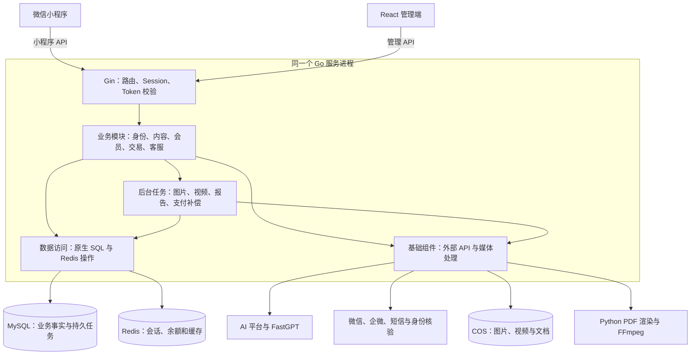

这张图表达代码调用关系，不推断服务实例数量。当前仓库未提供可确认的 Nginx、容器编排、Kubernetes 或 CI/CD 配置，不能把它们画成已经部署的组件。COS 对象存储也不自动等于已经部署 CDN。

服务端的目录分工如下：

| 目录 | 当前作用 | 架构判断 |
|---|---|---|
| `route/` | 路由注册、参数校验、业务编排，部分统计 SQL 也在这里 | HTTP 层与业务层尚未充分分离 |
| `processor/` | 微信、密码、手机号登录策略 | 局部采用策略模式，不是全业务统一 Service 层 |
| `model/` | 数据结构、原生 SQL、建表、迁移兼容与部分业务规则 | 没有使用 GORM；模型同时承担仓储和一部分领域逻辑 |
| `component/` | 数据库、Redis、COS、请求池、AI 适配、短信、核验、媒体处理 | 包含基础设施，也包含较重业务编排 |
| `function/` | Token、签名、密码、上传等工具 | 跨模块工具集合 |
| `report/` | Service、Worker、Store、Renderer、Storage、Catalog 接口 | 边界相对清楚，最值得参考的模块结构之一 |
| `reportwecom/` | 报告交付的企微票据、身份验证和欢迎消息 | 报告交付专用适配模块 |
| `sql/`、`cmd/` | 迁移、补历史数据、图片变体回填、账号合并等 | 证明系统已经处理存量数据演进问题，不能只按新建表考虑升级 |

启动顺序是：读取本地环境 → 初始化日志/配置/COS → MySQL/Redis → 多个表和兼容迁移 → 加载会话及余额缓存 → 初始化支付和认证策略 → 启动图片处理器和视频恢复 → 注册接口、报告 Worker、支付补偿 → Gin 监听。

依据：[[service/main.go|func main()]]；[[service/route/index.go|func RegisterRoutes]]；[[service/component/database.go|func InitMySQL]]；[[service/component/report_pdf.go|func (commandReportPDFRunner) Run]]。

## 3. 小程序前端：页面驱动的原生应用

### 3.1 页面组织与状态

底部主入口是首页、模板广场、设计师中心、个人中心。首页承担 AI 工具、设计场景和客服等能力的分发。生成、详情、订单、钱包、邀请、认证、报告等页面通过普通页面或分包承载。

页面基本采用 `Page({ data, onLoad, onShow, ... })` 和 `setData`。全局 `App` 管理少量通用能力，例如内容拦截弹窗、启动邀请码和 Tab 图片预热；业务状态主要留在页面、本地 Storage、页面缓存及页面跳转参数中。仓库未采用 Taro/uni-app，也没有集中式 Redux/Pinia 类状态架构。

`app.json` 配置自定义 TabBar、分包预加载、`lazyCodeLoading: requiredComponents` 和 `glass-easel`。存在 Skyline 配置段，但仅凭这段配置不能断言所有页面都使用 Skyline 渲染。

### 3.2 网络层与长任务

普通页面直接调用 `wx.request` 的情况较多；工具、收藏、支付、报告等能力已有局部 API 封装，但还没有全项目统一的请求客户端。很多文件分别定义相同 API 域名，环境切换和全局错误策略容易分散。

AI 请求一般经过 `generateRequestParams`、`paramsToHeaders`；上传也使用同类鉴权参数。聊天通过 `enableChunked: true` 与 `onChunkReceived` 消费服务端 SSE 事件。图片生成提交后只拿任务号，进度页采用 `setTimeout` 分级延迟轮询；成功跳结果，失败显示原因。轮询生命周期在部分页面有清理实现，但还不是统一任务订阅服务。

### 3.3 已有性能设计

`utils/perf.ts` 用有过期时间的 `Map` 存页面数据，限制最多 80 个缓存项、160 个预取图片记录；通过 `wx.getImageInfo` 预热少量图片。它是有容量限制的插入顺序缓存，读取时没有重新调整顺序，不应称为完整 LRU。

模板广场按主/次/三级分类、关键词构造缓存键，使用请求序号防止过时返回覆盖当前列表，并预取详情和图片。模板详情还有用户范围缓存相关测试，说明“公共数据”和“个人解锁/会员状态”需要不同缓存范围。

值得复用的是：**主包保留高频入口、低频流程分包；列表缓存与图片预取配合；使用请求序号处理快速筛选导致的返回乱序。**迁移时建议统一请求、登录失效处理和轮询生命周期，再复制页面。

依据：[[miniprogram/miniprogram/app.ts|onLaunch]]；[[miniprogram/miniprogram/utils/perf.ts|const pageCacheStore]]；[[miniprogram/miniprogram/pages/template/template.ts|requestSerial:]]；[[miniprogram/miniprogram/pages/generateprogress/generateprogress.ts|function getTaskStatusPollDelay]]；[[miniprogram/miniprogram/pages/chat/chat.ts|enableChunked: true]]。

## 4. 身份、登录与权限：三种请求身份形态

### 4.1 登录流程

微信登录用 `wx.login` 的 code 换真实 `openid/unionid`，先按 openid 查用户，再按 unionid 识别并补绑定，必要时兼容历史设备会话，最后生成业务会话。手机号验证码登录通过 `user_identities` 找到用户；找不到时创建用户及资料并绑定手机号。密码登录使用注册好的策略；管理端使用 management 用户类型的密码策略。

`users` 存基本账号和微信身份，`user_profiles` 存展示资料及部分验证信息，`user_identities` 承载手机号等身份凭证，`code_sessions` 表和 Redis 承载业务会话。系统正在从历史身份存储走向统一凭证，但微信身份尚未完全收敛到单一身份表，不能把它描述成已经完成的统一身份中心。

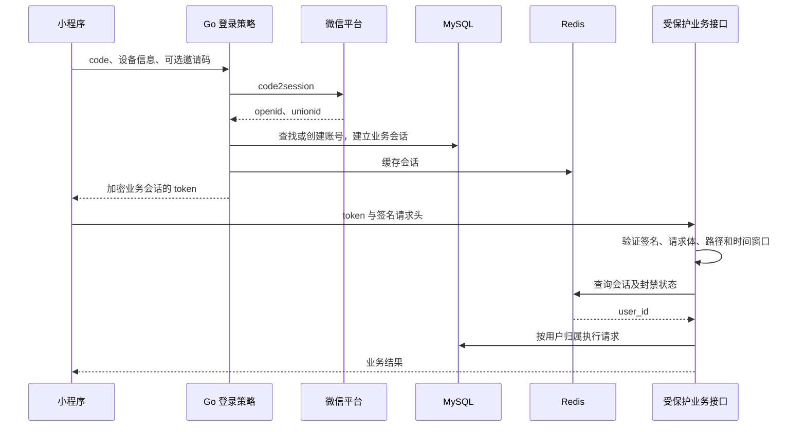

### 4.2 不要把所有 token 当成 JWT

| 请求类别 | 实际凭据 | 校验位置 |
|---|---|---|
| 小程序 AI 等完整鉴权接口 | 加密会话 token、`token-signature`、`sin`、`md5-signature`、`pass`、`tm` | `TokenAuthRequired` 校验 token、请求体/路径、设备参数、300 秒时间窗口与封禁状态 |
| 小程序部分用户数据/签到接口 | token | 局部 `simpleTokenAuth` 解密 token 并查询会话；没有完整请求签名链 |
| 管理端 | Redis Session + `sessionid` Cookie | `AuthRequired` 检查 Session 的 `user_id` |

管理端 localStorage 的 `admin_token = session_active` 只是前端登录标识。Fetch 虽然附加 `Bearer`，真正的后台身份依据仍是 Cookie，不是这个固定字符串，也不是 JWT。

### 4.3 可复用部分与边界缺口

可复用登录策略接口、账号与凭证分离、多设备归属识别、业务接口的资源归属检查。自定义 SM4/MD5 多段签名不适合直接作为新项目的安全基础：客户端含默认共享参数、部分接口使用简化鉴权，而且时间窗口不等于每笔业务的防重放/幂等。

**当前重要缺口：管理端中间件只判断是否登录，没有判断 `user_type == management`；小程序登录也写入同一个 Session 体系。**因此源码所显示的管理接口权限边界不足，应先补服务端管理员角色校验，再考虑细粒度 RBAC。前端 `ProtectedRoute` 不能弥补服务端缺失的权限判断。

依据：[[service/processor/auth_strategy.go|type AuthStrategy interface]]；[[service/processor/wechat_auth.go|func (s *WechatAuthStrategy) Login]]；[[service/processor/phone_auth.go|func (s *PhoneAuthStrategy) Login]]；[[service/route/middleware.go|func AuthRequired]]；[[service/route/middleware.go|func TokenAuthRequired]]；[[service/route/miniprogram.go|SetUserSession(c, result.User.ID]]；[[background/src/api/auth.ts|tokenUtils.setToken]]。

## 5. AI 图片与设计工具：共享执行引擎、多种业务入口

### 5.1 普通生成的完整调用链

入口包括 `aigenerate`、`aitoolworkbench`、模板做同款和多个专用设计页面。通用提交接口是 `POST /api/v1/miniprogram/ai/draw`，请求核心为 `scene + payload`。

1. 后端根据 scene、tool_id/tool_code、模板 ID 重新读取工具与模板配置，补充内部提示词、预设风格和参考图。
2. 根据 `ai_pricing` 的场景单价与生成张数计算扣费；通用生成张数最多 3 张。
3. Redis Lua 原子检查余额并扣减。
4. 通用生成在一个 MySQL 事务中写入消费流水、消费订单和 pending 任务。若数据库操作失败，尝试退回 Redis 灵石。
5. 返回任务编号；页面进入轮询。
6. `AITaskProcessor` 每 2 秒从任务表领取最多 10 个 pending 任务。领取使用 MySQL 事务、`SELECT ... FOR UPDATE` 和状态更新，提交前已将任务改为 processing。
7. 请求池由 CPU/可用内存估算 Worker 数，使用有界 channel 队列；调用对应供应商协议，必要时按候选模型/通道降级。
8. 下载供应商结果，生成水印图、原图和缩略图等资产，上传 COS；记录真实模型、接口、外部任务号与尝试信息。
9. 写 success/failed。部分出图可按缺失张数退灵石；全部失败尝试全额退回。

```mermaid
%% name: image-task
sequenceDiagram
    participant page as 生成页面
    participant api as AI 路由
    participant balance as Redis 余额
    participant db as MySQL
    participant worker as 任务扫描与请求池
    participant vendor as AI 供应商
    participant files as COS
    page->>api: scene、输入、工具或模板标识
    api->>db: 读取计价和服务端提示词配置
    api->>balance: Lua 原子检查并扣费
    balance-->>api: 扣费成功
    api->>db: 事务写任务、消费流水和订单
    alt 数据库写入失败
        api->>balance: 尝试退回扣费
        api-->>page: 提交失败
    else 创建成功
        api-->>page: task_no
        worker->>db: 锁定 pending 并改为 processing
        worker->>vendor: 请求生成，必要时切换候选通道
        vendor-->>worker: 图片结果或失败
        worker->>files: 保存原图、水印图和缩略图
        opt 部分出图或全部失败
            worker->>balance: 尝试退回未交付部分
        end
        worker->>db: 写结果、模型信息和最终状态
        page->>api: 按任务号轮询
        api->>db: 查任务并检查归属
        api-->>page: 状态、展示结果、结算信息
    end
```

这里的持久任务队列是 **MySQL 的 `ai_tasks`**，Redis 用于余额等其他状态，进程内 channel 用于执行排队；没有发现 RabbitMQ、Kafka 或 Redis Stream 队列。图中的 COS 保存步骤适用于存在成功结果的情况，全部失败不产生图像资产。

### 5.2 工具配置化是最有价值的扩展点

`ai_tools` 描述名称、分类、封面、说明、默认提示词、参考预设、风格预设、排序、是否常用和发布状态。管理端修改配置后，小程序工具列表、详情和通用工作台读取同一份配置。

风格预设明确区分：`preview_only` 只给用户展示；`preview_and_model` 还将指定图送给模型。服务端按预设 ID 取真实配置，拼接“工具默认提示词 + 参考预设后缀 + 风格后缀 + 用户补充”。这比每个工具独立开发一套生成引擎更易扩展。

公共工具响应不包含顶层 `default_prompt`，但预设结构仍有 `prompt_suffix` 字段，因此不能声称工具全部提示词都不会暴露。模板内部提示词另有保护路径。

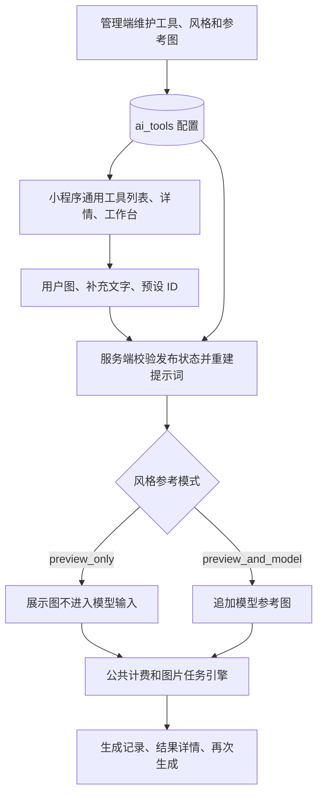

### 5.3 专用业务场景如何落到同一引擎

| 模块/入口 | 输入与规则 | 服务端实现 |
|---|---|---|
| 乡村别墅 `ruralvilladesign` | 地块尺寸/示意图、建筑风格、地块描述、参考图 | `/ai/rural-villa-design`，`buildRuralVillaPrompt`，写 `rural_villa_design` 任务 |
| 全能设计 `allrounddesign` | 风格变换、海报、文创；原图与参考图分别组织 | `/ai/allround-design`，按 design_type 构建提示词，进入图片队列 |
| 建筑换新 `buildingreplacement` | 外立面/室内图、改造方向、材质及补充要求 | `/ai/building-replacement`，专门的提示词组装 |
| 亲子创意 `Parentchildcreativity` | 玩偶、海报、文创类型，原型、风格和参考图 | `/ai/parent-child-design`，生成张数计价后进入图片队列 |
| 新闽派 `newminnantool` | 文生图或图生图、地域风格规则 | `new_minnan_tool_text_to_image/image_to_image`，服务端补风格词，走 RunningHub 专用异步协议 |
| 模板做同款 | 模板 ID、原任务载荷或内部提示词、展示参考图 | `/templates/:id/generate`，校验付费模板解锁后创建图片任务 |

这些场景共享的是任务执行设施，而不是完全一致的提交事务。专用设计路由仍有各自扣费、写流水和建任务代码，不能把通用 `/ai/draw` 的事务保证直接套在所有设计入口上。

### 5.4 迁移时应补上的能力

图片任务虽然能避免两个 Worker 同时领取 pending，但未看到 processing 任务的租约、超时回收和启动恢复。进程在领取后退出，任务可能持续停在 processing。供应商请求超时也不必然代表对方没有执行，降级可能产生额外外部成本。

建议复用“场景配置 → 任务记录 → 有界执行池 → 供应商适配 → 自有资产归档”的结构，补上任务租约、独立结算幂等键、重试次数、外部任务状态持久化和全局供应商限流。

依据：[[service/route/ai.go|func handleAIRequest]]；[[service/model/ai_task.go|func (m *AITaskModel) ClaimPendingTasks]]；[[service/component/ai_task_processor.go|func (p *AITaskProcessor) processPendingTasks]]；[[service/component/ai_task_processor.go|func (p *AITaskProcessor) handleTaskResult]]；[[service/component/requests.go|func CalculateOptimalPoolSize]]；[[service/component/requests.go|func (p *RequestPool) executeImageTaskWithFallbacks]]；[[service/route/ai.go|func enrichAIToolPayload]]；[[service/route/ai_tool.go|func buildAIToolPublicResponse]]。

## 6. AI 视频：独立状态机与供应商任务监控

视频不直接走图片请求池。`ai_video.go` 定义供应商适配接口，包含老张视频接口和方舟 Seedance 实现；具体选择来自配置。页面可提交文本、单图或首尾帧等输入，服务端扣费并向供应商创建任务，得到外部 ID 后保存 `ai_video_tasks`。

单段视频由后台监控协程和前端轮询共同触发同步。状态统一映射成 queued、processing、completed、failed；如果供应商已 completed 但自有结果 URL 还未就绪，对用户继续表示处理中。成功后下载、处理水印并上传 COS，避免把供应商临时 URL 直接当成最终交付。

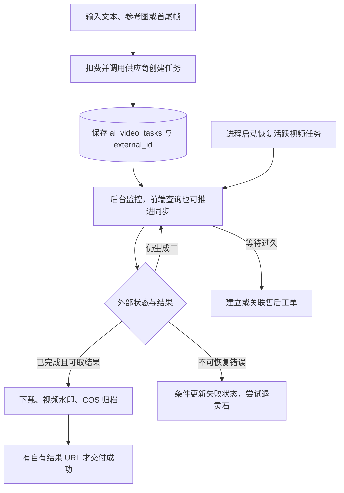

还有多段连续视频路径：依次生成片段、利用供应商返回的上一段尾帧衔接继续生成，再用 FFmpeg 拼接。这一流程的片段执行状态主要在协程和内存变量中，不能等同于完整的断点续跑工作流。启动恢复会扫描最多 200 条活跃视频记录，但“恢复监控”不代表“恢复多段生成的中间执行现场”。视频水印失败时当前路径会继续归档原片，因此水印不是强制交付前置条件。

单段失败处理用数据库条件状态更新控制退款触发资格，比纯内存标记更有价值；但退款额度按当前计价配置重新计算，而非读取任务创建时冻结的费用，迁移时应改为收费快照。`sync.Map` 中的任务锁仅约束本进程，并非跨实例分布式锁。

可复用：外部状态归一化、自有 URL 才算交付成功、长时间等待转售后。需要补强：分段步骤持久化、跨进程协调、费用快照、媒体处理失败策略。

依据：[[service/route/ai_video.go|type aiVideoProviderAdapter interface]]；[[service/route/ai_video.go|func StartAIVideoTaskMonitor]]；[[service/route/ai_video.go|func ResumePendingAIVideoTasks]]；[[service/route/ai_video.go|func markAIVideoTaskFailed]]；[[service/route/ai_video.go|func runContinuousVideoChain]]；[[service/model/ai_video_status.go|func EffectiveAIVideoStatus]]；[[service/component/video_watermark.go|func ConcatVideos]]。

## 7. 聊天、智能客服与建筑规范问答

### 7.1 普通 AI 聊天

`/ai/chat/stream` 接收 messages 与可选 system_prompt，按场景配置扣费，调用主模型或备用通道，通过 SSE 返回 content、done、error 等事件。聊天页增量更新消息，也可以从聊天整理提示词再发起图片任务。

它主要是应用后端代理模型对话；没有证据表明所有聊天都统一进入持久化会话中心。建筑规范问答另有明确的会话和消息表。

### 7.2 客服是“规则分流 + AI 表达 + 线索经营”

`/ai/intent/stream` 的代码优先级是：知识库规则命中 → 高意向关键词转人工 → 中意向建筑/案例引导 → AI 意图分类兜底。结果包含 intent_type、intent_level、guide_action，前端据此展示生成、模板、造价、人工或需求收集入口。它不是每次都让模型自由决定所有动作。

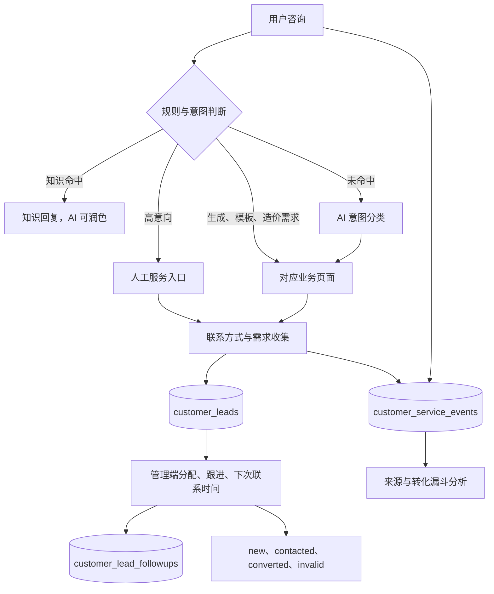

`session_no` 关联一次咨询，`source_task_no` 关联生成结果，lead_id 关联线索，事件表记录入口曝光/点击/提交等过程，跟进表保留运营动作。客服模块因此可以用于追踪“用户从哪张生成图进入咨询、留下什么需求、最后是否转化”。漏斗是事件统计，不应直接等同于经过严格归因验证的成交率。

### 7.3 建筑规范问答

文档上传经格式/大小检查后上传 COS，建立 `building_code_documents`，并异步导入 FastGPT。当前上传默认写入 public、approved 并立即索引；虽然管理接口提供审核、禁用和重新索引，但人工审核并非当前上传流程的强制前置门槛。提问时检查会话归属，保存用户消息，把问题发给 FastGPT，流式返回正文与引用，再保存回答和引用信息。

FastGPT 完全无输出且失败时，代码会降级到通用模型，并向前端明确发送“未检索到规范原文”的 notice。不能把降级结果当作有规范引文支撑的 RAG 回答。

检索、切分、向量索引等能力属于外部 FastGPT；仓库没有自建向量数据库实现。管理端有相应后端接口，但注册的 25 个管理页面里没有独立的建筑规范管理页面，不能仅凭 API 就判定可视化运营闭环已完成。

可复用：规则优先的意图路由、结构化 action 输出、业务来源关联、正文和引用分别保存、降级能力显式标记。

依据：[[service/route/ai_chat_stream.go|func handleChatStream]]；[[service/route/ai_intent_stream.go|func handleIntentStream]]；[[service/route/customer_service.go|func RegisterCustomerServiceRoutes]]；[[service/model/customer_service.go|type CustomerLead struct]]；[[service/route/building_code.go|func handleBuildingCodeChat]]；[[service/route/building_code.go|func importBuildingCodeToFastGPT]]。

## 8. 模板、灵感、收藏与设计师：内容生产到消费

### 8.1 模板广场和做同款

模板记录不仅是图片，还包括分类/Tab、缩略图、多图、价格、状态、发布范围、作者、内部提示词及可选原始任务 ID。管理端配置分类、Tab、精选案例组，审核和发布内容；小程序展示公开的 square 范围内容，设计师主页可以使用独立发布范围。

“做同款”优先从原始 AI 任务恢复请求载荷；没有可用原任务时，使用模板内部提示词与展示参考图组装新任务。付费模板先检查解锁，再按生成费用提交任务；原任务是否可用由查询结果判断，不只检查非零 ID。

模板公开响应不直接返回 `InternalPrompt`。后端组装输入时设置隐藏标记，避免把内部提示词作为普通展示数据返还。迁移时仍需核对历史详情接口、任务载荷回包和存量 description 的数据清理，而不是只隐藏前端文本。

### 8.2 三种资产下载权限不同

| 资产 | 当前主要权限条件 | 技术路径 |
|---|---|---|
| 模板图片 | 登录 + 手机号资料 + 有效下载会员，兼容历史成功充值资格 | 后端生成下载入口，按套餐校验有效期、总量、每日量、频率，文件代理下载 |
| 用户自己的 AI 图片原图 | 任务属于当前用户、已成功、已有手机号授权相关验证标记 | 查询结果中的 raw_images/url_raw，或经后端文件代理 |
| 完整建房报告 | 所属用户、已支付、真实企微联系人绑定、报告 ready | 私有 COS 的限时签名下载 |

模板“解锁”与模板“图片下载会员”是两套判断：前者主要约束付费模板使用，后者约束下载资格。AI 原图中的 `EnterpriseWechatVerified` 历史命名在当前路径也能由手机号授权验证设置；它不能替代报告模块对真实企微联系人身份的验证。

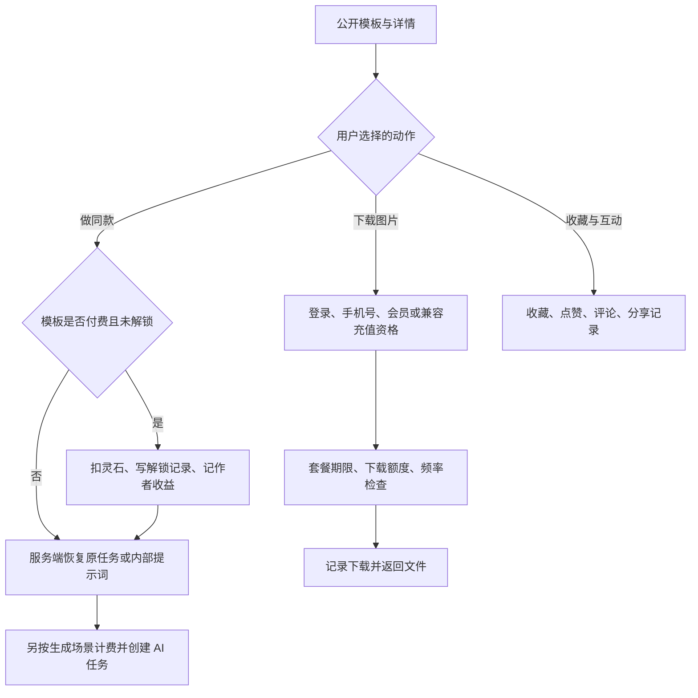

模板解锁现在分步执行扣费、记订单、建解锁记录、给作者加灵石，不在统一事务里，且部分错误被忽略。并发解锁与中途失败可能造成重复扣费、收款与授权不一致，这一段不能原样作为数字商品交易模块复用。

### 8.3 通用收藏和灵感素材

`user_favorites` 使用 `user_id + target_type + target_id` 唯一键，统一收藏模板、AI 工具、设计师和灵感。`INSERT IGNORE` 让重复添加自然幂等；响应层把不同对象适配成同一收藏卡片。模板收藏同时兼容历史点赞数据，属于迁移兼容设计，不能假设收藏和点赞已经完全分离。

`inspiration_assets` 负责灵感素材，独立管理和审核；`utility_tools` 负责实用工具内容，属于内容型工具，不应与会发起 AI 任务的 `ai_tools` 混为一谈。

### 8.4 设计师与认证

认证流程是：个人/企业信息校验 → 阿里云基础核验 → 创建待支付申请 → 支付成功推进待审核 → 管理员通过或拒绝 → 同步认证衍生权限和主页展示状态。可继续支付未完成申请，审核前后还会检查账号与认证资料一致性。

设计师主页聚合作品、介绍、认证、订单、收入、评价和关注，公开状态与是否接单可在管理端调整。模板消费订单可关联设计师及模板，为评价和收益统计提供业务依据。

`can_withdraw` 是认证衍生资格，不代表提现通道当前可用；当虚拟支付启用时，提现接口主动返回维护状态。语音通话页面和消息中心目前仅有少量界面交互/空数据，不构成完整的实时通信与通知服务。

依据：[[service/route/template.go|func buildTemplateGeneratePayload]]；[[service/route/template.go|func resolveTemplateDownloadAccess]]；[[service/route/template.go|templatesAuth.POST("/:id/unlock"]]；[[service/component/download_limiter.go|func (dl *DownloadLimiter) CheckDownloadAccess]]；[[service/model/user_favorite.go|func (m *UserFavoriteModel) InitTable]]；[[service/route/favorite.go|func collectFavoriteRefs]]；[[service/route/certification.go|func RegisterCertificationRoutes]]；[[service/route/certification_management.go|func RegisterCertificationManagementRoutes]]；[[service/route/wechatpay.go|if cfg.VirtualPay.Enabled]]。

## 9. 灵石、会员、支付与邀请

### 9.1 账务对象的分工

| 对象 | 作用 | 需要注意 |
|---|---|---|
| `users.stones` + Redis `user:stones:*` | 用户灵石余额 | 常规增减先改 Redis，再用协程写 MySQL；当前不是数据库强一致总账 |
| `stone_records` | 签到、消费、退款、充值、邀请等流水 | 不同模块写法不完全统一，不能只凭余额变动推定流水完整 |
| `user_orders` | 充值、消费、模板文创、认证、提现、报告等业务订单 | `amount` 随订单类型有灵石/历史金额语义，现金支付应看 `amount_fen` 等明确字段 |
| `membership_plans` | 充值档位、时长、下载权益和限制 | 运营配置，服务端用于匹配权益 |
| `user_memberships` | 每用户当前会员、到期时间和来源订单 | 唯一 user_id，当前权益表，不是完整的每次权益发放账本 |
| `xpay_message_logs` | 虚拟支付回调日志和异常追踪 | 日志辅助排查，发货防重最终依赖订单状态处理 |

Redis Lua 能保证单次余额检查与扣减不被并发打断，但不能让 Redis、订单、流水、任务和第三方支付成为一个原子事务。后台多个请求并发异步回写余额，或进程退出后重新从 MySQL 覆盖 Redis，都存在需要收敛的账务一致性边界。

### 9.2 虚拟支付三路汇合

前端 `requestVirtualPay` 封装平台能力检查、重新 `wx.login`、`/virtualpay/prepare`、`wx.requestVirtualPayment` 和 `/virtualpay/confirm`。prepare 保存订单并返回签名字符串，前端原样透传给微信。

支付结果由三路推进：客户端 confirm、微信消息回调、每 60 秒的服务端补偿。它们复用服务端查询/发货逻辑，不应依据客户端弹窗成功直接充值。

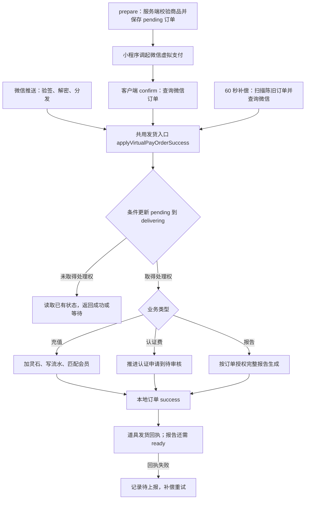

`pending → delivering → success` 的条件更新能阻止并发重复发货，但不等于整个交付具备端到端 exactly-once。尤其充值已加余额、会员发放失败、订单成功状态写失败等情况，仍缺少统一的权益发放流水和幂等业务键。

当前补偿先把超过 30 分钟的 pending/delivering 直接改 failed，再扫描超过 2 分钟的订单。扫描虽然包括 delivering，但推进函数对 delivering 直接返回 PAYING，没有租约回收；因此崩溃遗留的 delivering 可能等待到被标失败，不能描述成已经可靠修复中间态。对于支付状态不确定的订单，迁移时应先查单/对账，再决定终态。

### 9.3 会员、签到与邀请

充值成功按金额匹配会员档位，延长或授予下载权益；未匹配档位时还有长期下载会员兼容逻辑。有效性和下载限制在后端判断。扩展时建议用独立的权益发放记录保存订单幂等键和历史快照。

签到由每日唯一记录约束，再按连续天数发灵石，当前奖励为第 1/2/3/4/5/6/7 天及以后 5/10/20/25/30/35/40。签到记录、余额和流水仍是分步处理。

邀请采用后端生成的六位唯一邀请码。小程序保存待绑定的邀请码，登录或主动核销时校验邀请人、自邀请和既有关系，绑定成功双方各得 50 灵石。分销后台聚合邀请关系与奖励流水。

虽然存在 `invite_rewards` 模型和“首充 10%、AI 每次奖励”的历史注释，本次未在主启动/实际充值及 AI 执行链中找到完整接入。应把“邀请绑定和注册奖励”视为已确认逻辑，不应据此宣称持续返佣系统已经落地。

依据：[[service/model/user_redis.go|func (m *UserRedisModel) DeductStones]]；[[service/model/user_redis.go|func (m *UserRedisModel) syncStonesToMySQL]]；[[miniprogram/miniprogram/utils/virtualpay.ts|export async function requestVirtualPay]]；[[service/route/virtualpay_apply.go|func applyVirtualPayOrderSuccess]]；[[service/route/virtualpay_compensate.go|func (vc *VirtualPayCompensator) tick]]；[[service/model/user_order.go|func (m *UserOrderModel) MarkVirtualPayPendingExpired]]；[[service/model/user_membership.go|type UserMembership struct]]；[[service/model/invite_reward.go|type InviteReward struct]]。

## 10. 造价与建房报告：两个不同产品链路

### 10.1 基础造价和 Excel 测算

`/ai/cost/calculate` 当前是固定规则：按面宽、进深、层数扣除庭院/露台得到面积，再按结构与屋顶系数计算主体、基础、屋面、门窗、外墙、水电等费用。城市虽是输入项，但不是实时地区价格服务。它不调用大模型，也不是已经接入专业计价数据库的造价引擎。

`/ai/cost/doc` 则创建 ai_cost_doc 任务，单独启动协程，调用方舟 Responses 接口取得结构化章节/Markdown 表格，再由 Go Excelize 写成多个工作表并上传 COS。它故意不让普通图片任务扫描领取。

值得复用的是“内容生成 → 结构解析 → 确定性文件输出”的分层，而不是固定单价及字符串表格解析本身。文档任务如启用收费，当前任务 `StonesUsed` 仍设置为 0，是统计和退款审计需要修正的地方；这一路也没有报告 Worker 的租约恢复能力。

### 10.2 建房报告的领域模型更完整

报告分包包含 landing、questionnaire、preview、delivery。五步问卷收集地块、家庭、空间、风格/优先级和预算；服务端对数值、枚举、文本长度做边界检查，将规范化输入序列化并算 SHA-256。

报告按“用户 + input_hash + protocol_version”去重。首次创建预览任务；Worker 根据规则生成事实和正文，可让 LLM 辅助有限文本，失败时退回规则文本。生成的预览被冻结为快照。完整版基于已冻结的预览和经审核的方案包版本扩充，再交给固定 A4 渲染器。

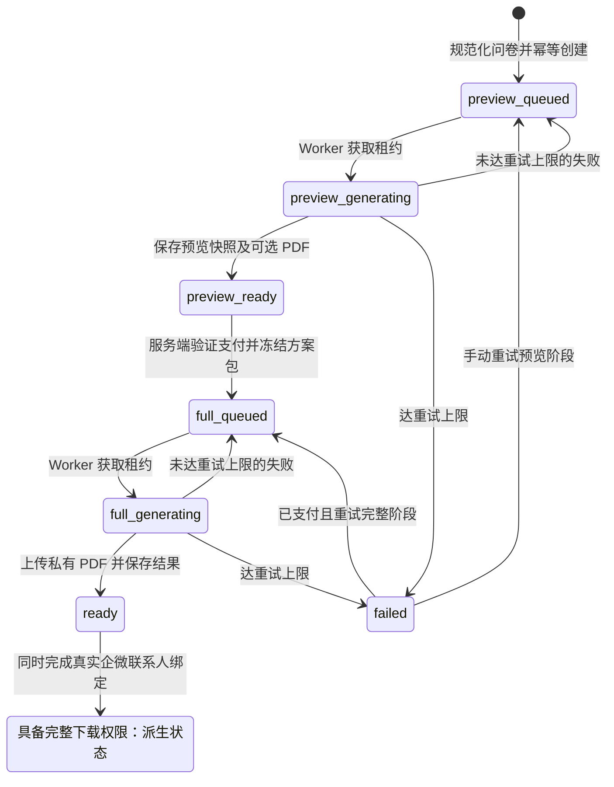

图中的 downloadable 是权限判断结果，不是数据库 status 的新枚举。企微绑定可以独立发生；下载时同时检查 paid、bound、ready，而不是必须按图中最后一步的时间顺序操作。

### 10.3 为什么报告模块适合提炼成模板

| 机制 | 当前实现价值 | 可迁移场景 |
|---|---|---|
| 规范化输入 + hash + 协议版本 | 避免相同输入重复创建，支持规则演进 | 测评报告、报价单、申请材料、合同草稿 |
| 不可变预览快照 | 付费前后内容可追溯，避免每次随机重生成 | 付费报告、设计方案包、分析结果 |
| 方案包 ID 与版本冻结 | 支付时绑定明确产品与交付内容 | 数字商品、套餐、资料包 |
| `lease_token + lease_until + attempt_count` | 可回收超时任务，旧 Worker 不能覆盖新 Worker 的结果 | 导出、大模型任务、文件转换 |
| Store/Renderer/PrivateStorage/Catalog 接口 | 业务逻辑不绑定具体 SDK 和数据库 | 模块独立测试与替换基础设施 |
| 规则生成 + 有限 AI 辅助 | 事实和版面确定，AI 输出失败仍有结果 | 对格式和可解释性要求高的文档 |
| 私有文件 + 短时签名 | 把购买和下载权限收口到后端 | 付费附件与敏感文档 |
| 支付、绑定和生成状态独立 | 业务事实不塞进一个 status 字段 | 多条件交付流程 |

报告企微交付使用专用票据和回调：验证 external_user_id、unionid 与订单所属用户相符，并确认跟进员工。欢迎语用条件领取防止重复发送，对超时不确定情况标记 manual_required。普通手机号验证不满足这套真实企微绑定条件。

模块开启有准备检查：数据库结构、渲染程序、字体/资产、私有存储、方案包、支付与企微配置不足时，服务不可用或关闭购买入口。因此源码完整不代表当前环境已能售卖报告。

依据：[[service/route/ai_cost.go|func handleAICostCalculate]]；[[service/route/ai_cost_doc.go|func runCostDocPipeline]]；[[service/report/content.go|func MarshalInput]]；[[service/report/content.go|func (g *Generator) BuildPreview]]；[[service/report/mysql_store.go|func (s *MySQLStore) Claim]]；[[service/report/service.go|func (s *Service) GetDownloadURL]]；[[service/route/report.go|func NewReportModule]]；[[service/reportwecom/service.go|func (s *Service) verifyIdentity]]。

## 11. 管理端：业务操作台，而非第二套后端

### 11.1 前端结构

入口为 React SPA，`BrowserRouter basename="/admin"` 与 Vite `base: /admin/` 配套。路由使用 `lazy + Suspense` 分块，构建显式拆分 React/Router 等依赖。开发环境 `/api` 通过 Vite 代理到配置的服务地址。

`Layout` 组织侧栏、顶部栏和页面；`BookmarkProvider` 通过 Context 管理打开的路由标签及刷新标记。标签存在不等于页面组件被 keep-alive 缓存。数据请求通过 `src/api/*.ts → utils/request.ts → Fetch`；携带 Cookie，处理业务 code，再由页面 useState/useEffect 驱动列表、筛选和弹窗。

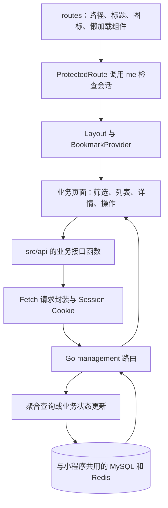

### 11.2 管理模块与后端职责映射

| 页面组 | 页面/入口 | 实现逻辑及主要数据 |
|---|---|---|
| 总控台 | dashboard | overview/trends/todos 三类聚合接口；统计新增用户、订单、任务、待认证和异常 |
| 用户运营 | users、user-workbench | 用户列表、余额调整、资料修正；360 接口一次聚合会员、订单、任务、流水及设备风险 |
| 设计师与认证 | designer-center、certification | 认证审核、公开主页、接单开关，设计师作品与评价摘要 |
| 内容配置 | templates、inspirations | 模板上下架、分类和 Tab、精选组、原始任务、隐藏提示词；灵感素材审核 |
| AI 配置 | ai-tools、ai-config | 工具/风格/参考图配置、计费场景与供应商请求配置 |
| AI 排障 | ai-tasks | 图片/视频任务列表、详情、真实执行模型、错误和工单关联 |
| 交易与会员 | recharge、virtualpay、recharge-config、membership-plans、membership-operations | 订单中心、虚拟支付日志/健康、充值与权益配置、到期用户筛选 |
| 客户经营 | customer-leads、distribution | 线索分配、跟进、状态、漏斗；邀请关系排行和奖励排查 |
| 分析 | content-analytics、report-center | 内容排行、转化观察、报表预览及 CSV 导出 |
| 风险与售后 | risk-control、support-tickets | 设备分组/异常支付/失败任务查询；创建工单、分配、解决说明和关闭 |
| 基础管理 | oss、logs、utility-tools | 文件列表上传删除、日志配置/查询、内容型实用工具 |

售后工单以 `source_type + source_id` 关联订单/任务等来源，状态为 open、in_progress、closed。自动或手动汇集异常后交给运营处理。当前按“是否已有未关闭工单”查询去重，不应等同于已实现数据库唯一约束的绝对防重。

运营报表直接查询业务库，并非独立数仓。数据量上升后，聚合查询会和交易/任务竞争数据库资源。尤其“download_count”部分代码同时在使用/生成路径增加，不能无条件解释为实际文件下载次数；应与 `template_download_records` 分开定义统计口径。

配置文件还留有 `/api/v1/admin/products`、gifts、warehouse 等地址，但没有对应的已注册管理页面和本服务路由支撑，视为遗留/预留接口，不应计入已经完成的电商仓储模块。

一个明确的前端问题是：全局 401 处理跳 `window.location.href = '/login'`，而管理端部署基路径是 `/admin`，需要改为与基路径一致的导航策略。

依据：[[background/src/App.tsx|<BrowserRouter basename="/admin">]]；[[background/vite.config.ts|base: '/admin/']]；[[background/src/component/ProtectedRoute.tsx|const checkAuth]]；[[background/src/component/bookmark.tsx|export const BookmarkProvider]]；[[background/src/utils/request.ts|window.location.href]]；[[service/route/user_workbench_management.go|func RegisterUserWorkbenchManagementRoutes]]；[[service/route/report_center_management.go|func RegisterReportCenterManagementRoutes]]；[[service/model/support_ticket.go|func (m *SupportTicketModel) ExistsOpenBySource]]。

## 12. 核心数据关系与边界

下面是核心逻辑关系，不是数据库外键约束声明。JSON 载荷与通过订单号关联的对象在实际模型中也较常见。

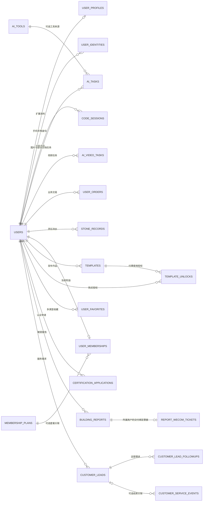

关系图中省略了评论、点赞、分享、关注、精选组、规范文档、配置及日志等边表，完整声明清单在 `code-index.md`。没有把支持工单来源、收藏多态 ID 等字段画成真实外键。

关键设计判断：

- **业务身份以 user_id 为中心**，但展示身份、登录凭证、认证状态、手机号授权和企微交付绑定是不同概念，不能只用一个布尔字段代替。
- **订单、资金流水和任务不是同一个状态机**：任务失败退款后，原消费订单仍可能保留历史消费语义。结算口径必须说明总消费、实际消耗和退款分别从哪里取。
- **任务载荷承担执行快照**：request_payload/result_payload 方便追溯，但也造成跨层依赖和动态字段泛滥，新增模块应定义版本化结构。
- **资产文件与业务记录分离**：COS 存文件，MySQL 存 URL/对象键和业务归属；公开图片与私有报告应使用不同的访问策略。

## 13. 复用到其他项目：提炼设计，再提炼代码

### 13.1 复用优先级

| 优先级 | 可提炼能力 | 适用项目 | 复用前处理 |
|---|---|---|---|
| 高 | 报告 Service/Worker/Store/Renderer/Storage 分层 | 测评、报告、报价、资料生成 | 去掉建筑事实与方案包规则，保留租约、快照、权限与接口 |
| 高 | 配置驱动的 AI 工具工作台 | 电商作图、营销素材、装修、教育创作 | 通用 ToolSchema、输入约束、PromptVersion、模板版本；补全端到端配置校验 |
| 高 | 统一生成资产与执行元数据 | 所有付费 AI 产品 | 确定原图/缩略图权限、资产过期、供应商成本和模型记录 |
| 高 | 线索 + 事件 + 跟进记录 | 企业服务、咨询、装修、培训 | 替换需求字段、定义事件版本、增加分配权限与去重策略 |
| 高 | 多类型收藏 | 内容社区、工具库、资源平台 | 移除模板点赞兼容，统一 TargetResolver，批量加载目标避免逐条查询 |
| 中 | 支付三路确认与统一发货入口 | 数字商品、会员和充值 | 必须补发货流水幂等、租约恢复、完整查单/对账与退款闭环 |
| 中 | 数据库任务表 + 有界 Worker 池 | 中小规模长任务 | 从报告模块引入租约，统一各类任务重试、关机与结算 |
| 中 | 管理端路由配置和用户360 | SaaS 运营后台 | 先补服务端 RBAC、基路径导航、统一分页/错误类型 |
| 低 | 当前余额实现、自定义签名、默认管理员逻辑 | 不建议直接作为新项目基础 | 重新设计账本与鉴权，移除固定默认凭据及生产调试暴露 |
| 低 | 固定造价规则、页面空壳、历史返佣注释 | 仅作产品需求参考 | 先定义真实数据来源与验收条件 |

### 13.2 建议的新项目结构

无需首先拆微服务。可以先保持单体部署，把“HTTP 参数转换”和“业务执行”拆开，并让同步接口与异步 Worker 复用同一个应用服务。

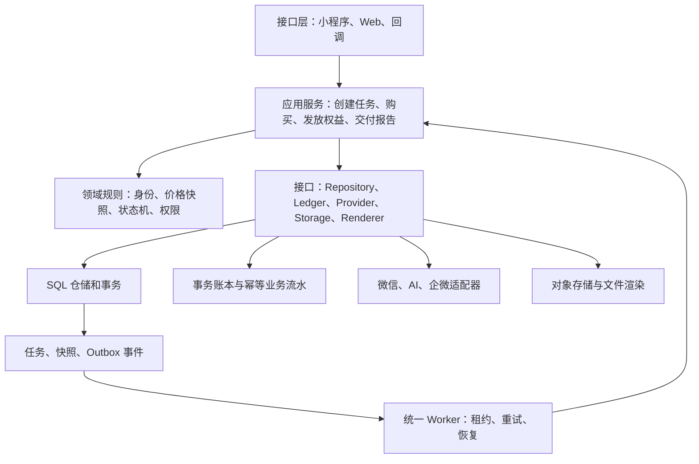

这是建议架构，尚未在当前项目实施。可按以下模块边界逐步提炼：

```text
internal/
  identity/        登录身份、凭证、角色与资源归属
  generation/      图片、视频、文档的任务和状态机
  billing/         价格快照、事务账本、退款与权益发放
  payment/         渠道查单、回调和对账
  content/         模板、工具、收藏及发布权限
  reporting/       输入协议、内容快照、方案包、渲染与交付
  crm/             线索、事件、跟进
  operations/      面向管理端的聚合读取
  infrastructure/  MySQL、Redis、COS、外部 API、FFmpeg
```

### 13.3 如何增加一个新 AI 工具

以“电商商品图生成”为例，可借鉴本项目工具体系：

1. 定义商品图工具输入：商品图、背景风格、文案、比例、张数；明确哪些参考图只展示、哪些送模型。
2. 在服务端保存 ToolSchema、提示词版本和预设，不让客户端直接决定收费或内部模板。
3. 管理端维护展示素材、发布状态和价格，小程序复用列表/详情/工作台。
4. 创建任务时冻结价格、提示词版本、模型策略与输入资产。
5. Worker 调供应商，归档原图、展示图、缩略图并记录执行元数据。
6. 用结算幂等键处理成功/部分成功/失败；让历史页、收藏、客服来源和后台任务排查复用同一任务 ID。

如果只是已有输入类型和规则的组合，配置即可覆盖大部分展示；如果新增模型协议、输入类型、审核或计价方式，就需要补接口与领域逻辑，不能承诺“完全零代码新增工具”。

## 14. 当前项目应优先补强的地方

以下为代码可见的问题和设计边界，不表示线上已经发生故障，也不包含生产利用测试。

| 优先级 | 发现与依据 | 影响 | 建议措施 |
|---|---|---|---|
| P0 | 管理端 `AuthRequired` 只查 user_id；小程序也建立相同 Session | 管理接口没有完整的服务端角色边界 | 独立管理员校验，所有 management 路由统一校验角色；随后补 RBAC |
| P0 | Redis 余额先增减、异步回写 MySQL，业务表不全在同一事务 | 崩溃、重启、并发回写和补偿时可能出现资金事实不一致 | 以事务账本为准，余额、流水、权益/订单采用明确事务或 Outbox 协调 |
| P0 | 支付补偿把陈旧 pending/delivering 直接置 failed；delivering 无实际回收推进 | 已支付未交付或半交付订单可能无法正确收敛 | 查单后决策、发货租约、逐项权益幂等、人工对账入口 |
| P0 | 默认管理员初始化含固定初始密码；密码哈希使用固定盐 MD5；工作区有支付私钥/证书文件 | 这类启动和凭据管理代码不适合作为复用模板 | 去除默认通用密码；采用专用密码哈希；核实敏感文件管理，按实际暴露情况处理凭据 |
| P1 | 图片 processing 无租约；造价/连续视频协程缺完整步骤恢复 | 进程重启可能留下卡住任务或丢失中间执行状态 | 借鉴报告 Worker 的租约、次数和带 token 的条件完成 |
| P1 | 模板解锁、签到/邀请奖励等分步处理，部分错误忽略 | 已扣费未授权、已记奖励未到账等 | 统一账务服务、业务唯一键与可重试发放记录 |
| P1 | 视频退款读取当前价格；造价文档扣费但任务记 0 | 价格变更后退款不准、成本统计不可靠 | 创建时冻结收费及价格版本，退款引用原记录 |
| P1 | 多处返回或保存原始资产 URL；严格私有交付主要在报告模块 | 不能从“前端按钮受限”推导文件本身受限 | 审核 COS ACL 与 URL 发放；付费资产使用私有对象和后端授权 |
| P1 | 小程序请求封装分散；管理端 401 跳转丢失 /admin 基路径 | 环境切换、登录失效、签名与错误处理不一致 | 提炼请求适配器，明确鉴权模式，集中处理导航 |
| P2 | 主要路由/组件超长，业务与 SQL 混杂 | 更改一个规则需追多个文件，难独立验证 | 按领域抽应用服务与仓储，优先从任务创建/结算开始 |
| P2 | 启动阶段大量建表/ALTER；缺可确认的部署和完整 CI 配置 | 升级过程与启动可用性耦合 | 显式版本迁移、分环境配置、发布检查与回滚说明 |
| P2 | 运营聚合直接查询业务库、统计字段复用 | 数据增长后数据库争用、运营口径含糊 | 统一指标字典，再按实际容量增加汇总表/只读查询能力 |

大型文件的代表包括：`route/miniprogram.go` 4071 行、`component/requests.go` 3302 行、生成详情页 2274 行、`route/ai_video.go` 1842 行。这些不是单独的质量判定，但与本次看到的跨层职责混合一致。

改造顺序建议为：**权限与账务边界 → 支付/任务恢复与幂等 → 统一请求和领域模块 → 运营指标与部署工程化**。不应先拆成多个服务再处理一致性问题，否则会扩大跨进程协调成本。

依据补充：[[service/function/password.go|func HashPassword]]；[[service/main.go|func createDefaultAdmin]]；[[service/route/virtualpay.go|func advanceVirtualPayOrder]]；[[service/route/ai_cost_doc.go|StonesUsed: 0]]；[[service/model/user_redis.go|func (m *UserRedisModel) LoadStonesFromMySQL]]。

## 15. 如何使用本次交付

`analysis.md` 是带可点击代码定位的分析正文；`analysis.source.md` 保留可自动更新代码行号的编辑源；`report.html` 提供完整阅读版；`diagrams/` 同时保留 Mermaid 源图和可直接使用的 SVG；`code-index.md` 与 `inventory.json` 提供页面、接口和数据表声明索引。

本次确认的是源码结构与关键实现链，不是线上验收报告。未启动后端、未调用收费接口、未测试真实支付、未运行数据库迁移；因此生产开关、表是否已迁移、模型额度、实际文件 ACL、部署可用性和吞吐上限仍需在独立验收中确认。当前环境的 Go 命令也未在 PATH 中找到。

这套系统最值得带到其他项目的是：**配置驱动的工具入口、异步生成与资产归档、支付多路确认、内容消费与设计师关联、客服来源追踪，以及报告模块的租约/快照/私有交付。**其中报告模块的职责分离和任务恢复设计，可以先反向应用到现有图片、视频和计费链路。
