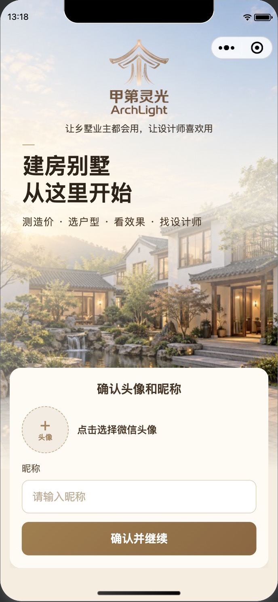

# 确认资料卡精简

按用户反馈删除昵称输入框下方的说明文字，同时移除嵌入确认卡标题下方和头像旁重复的次级提示。现在卡片只保留标题、单行头像选择提示、昵称输入和确认按钮。

修改文件：`miniprogram/miniprogram/components/nickname-guard/nickname-guard.wxml`、`nickname-guard.scss`。删除无用说明样式，沿用原字体、Logo、庭院场景和底部布局，无登录、上传、保存或隐私同意逻辑变更，无新依赖。

验证：修改前相关回归 58 项通过；修改后全量 756 项通过、0 失败、0 跳过；TypeScript、Sass、原生 WXML 编译与差异格式检查通过。生产依赖审计 0 漏洞；变更未包含凭据。

微信开发者工具中检查了 390×844 和 320×568，两种尺寸均能完整显示确认按钮。截图为本地组件测试状态；未提交真实账号资料。长屏原始截图保留为 `inline-profile-simple-native.jpg`，视觉复核见 `inline-profile-simple-verdict.json`。

尚未上传体验版；真机原生键盘及授权链路不在本轮视觉验证范围。变更可直接通过 Git 回退，无数据迁移。
