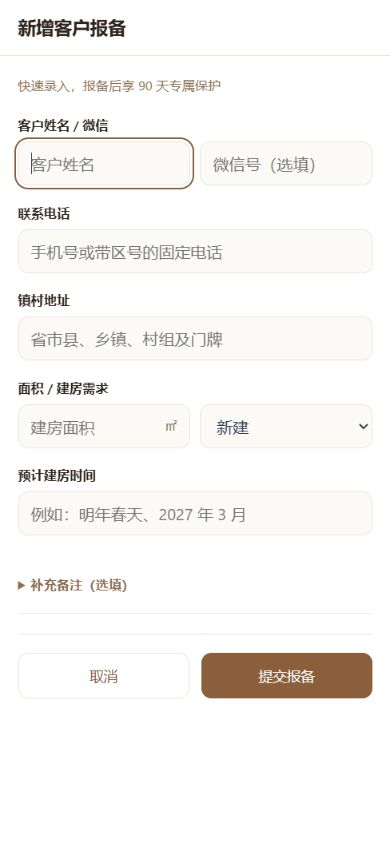
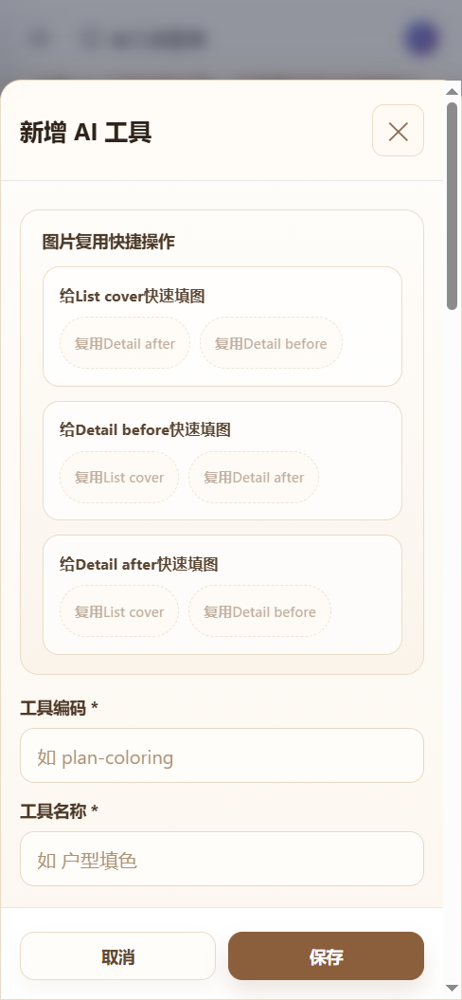

# 后台响应式检查与修复

日期：2026-09-15。范围：现有 React 后台的 26 个路由（25 个业务入口及登录），以及客户管理 9 个栏目。

## 结果与边界

已修复客户卡片错位、长编号挤压、页面双滚动、宽表格撑开布局、弹窗操作按钮过高、手机筛选区拥挤及页面样式互相污染。保留现有业务行为和“记住密码”。

**8092 是隔离的 CRM 联调服务，注册了客户管理和原始小程序线索接口，并不是完整平台服务。** 工单、支付、模板等模块返回 404 是环境能力缺失。本轮确认了这些页面的结构和加载失败状态；未把零值、空列表或占位内容当成真实业务数据，更未据此认定业务接口已通过。

## 显示规则

- 后台壳层占满可用视口，内容区负责纵向滚动；宽表格只在自身区域横向滚动，并提供提示与键盘焦点。
- 导航在 1024px 及以下使用抽屉，关闭后移出键盘访问范围，打开后管理焦点，支持 Escape 关闭并返回菜单按钮。
- 客户列表按实际可用容器宽度切换：900px 及以下为独立卡片，更宽时使用表格。卡片包含姓名/电话、编号、咨询类型、意向/阶段、负责人、下次跟进及保护期限。列表编号单行省略，完整编号可在详情查看。
- 手机报备继续使用五组信息；窄屏下姓名/微信及面积/需求可上下排列。备注默认折叠。
- 通用搜索区域在手机上合理换行，输入框和筛选项不突破可用宽度；输入字号至少按 16px 设置。
- 弹窗限制可用宽高，长表单可滚动，操作区保持横向按钮，不继承会把按钮高度撑到 140px 的纵向布局。
- 24 份按需加载的页面样式按路由隔离；小程序线索同时支持独立页面和 CRM 内嵌页面。客户样式继续限定在 CRM 容器。

## 步骤与截图

1. **客户列表：已修复。** 用户截图中的卡片混用了两套表格布局。现在使用独立卡片组件，不再把表格单元格强行转成卡片。

   

2. **新增报备：显示正常。** 五组信息和取消/提交按钮完整可见，默认备注折叠，长表单仍可滚动。

   

3. **通用配置弹窗：已修复。** AI 工具长表单已验证打开、滚动及取消，底部按钮不再异常拉高。未保存配置或上传文件。

   

4. **通用导航与表格：尺寸检查通过。** 手机导航打开、焦点移动和 Escape 返回已验证；数据表格保持原始语义，并在自身区域滚动。风控与支付监控的窄屏撑开问题已修复。

5. **错误和版本更新：已处理。** 自动加载失败显示页内原因和重新加载入口，不再阻塞整页连续弹窗。当前用户客户页已恢复正常显示。

原始问题参考：[用户提供的截图](responsive-audit/01-reference.png)。这里只保留已查看且可用的截图；早期尺寸未实际生效或画面裁切的调试截图未作为验收依据。

## 验证记录

- 25 个业务路由 × 实际 320、768、1440px = **75 项尺寸检查**。检查页面实际 `innerWidth`，内容横向溢出、外层横向溢出及外层额外高度。最终记录均未发现页面溢出；局部宽表格允许滚动。[原始测量](responsive-audit/verified-measurements.json)
- 客户管理 9 个栏目 × 实际 320、740、1440px = **27 项尺寸检查**，无整页横向溢出。[原始测量](responsive-audit/crm-measurements.json)
- 补查手机/平板及导航断点两侧，页面实际宽度为 768、770、1024、1026px（设备缩放存在整数舍入），导航及卡片切换正常。[断点记录](responsive-audit/breakpoint-checks.json)
- 登录页实际 320px 下无横向溢出，输入字号 16px，密码默认隐藏，“记住密码”仍保持勾选。未修改用户密码或存储规则。
- 客户卡片打开详情、关闭返回，新增报备打开及取消、导航焦点及 Escape、工具配置弹窗打开与取消均已操作验证。
- TypeScript 类型检查通过；Vite 生产构建通过；Git 差异空白检查通过。后端业务代码本轮未修改，因此没有重复声称已重新运行后端业务测试。

## 各页面覆盖

| 页面 | 本轮覆盖 |
| --- | --- |
| 客户管理 | 9 栏目、真实联调数据、列表/详情/报备及尺寸 |
| 客服线索工作台 | 原线索联调数据、只读列表及尺寸 |
| 登录 | 窄屏、隐藏密码、记住密码保持 |
| 用户 360 工作台 | 检索入口结构；具体用户详情需完整平台数据 |
| 后台总控台、用户管理、订单中心、虚拟支付监控 | 结构、错误态及三种尺寸；完整平台接口未接入此演示服务 |
| AI 任务中心、异常工单中心、资质认证与审核、设计师中心 | 结构、错误态及三种尺寸；数据详情仍需完整环境验收 |
| 用户会员运营、分销邀请中心、内容运营分析、风控台、报表导出中心 | 结构、错误态、宽表格区域及三种尺寸 |
| 模板广场管理、灵感素材审核、日志管理、OSS 管理 | 结构、错误态、搜索区域及三种尺寸；模板标题乱码修复 |
| AI 配置、AI 工具、充值配置、会员计划、实用工具 | 结构、错误态及三种尺寸；另实际检查工具长表单弹窗 |

## 本轮代码自审和修复

1. 全局卡片化样式与 CRM 局部规则冲突：删除全局表格卡片化及表头标签注入；客户使用独立卡片布局，其他数据表保留横向比较能力。
2. 基础盒模型未由实际入口加载：在实际加载的全局样式中补齐 `border-box` 和 body 零边距；弹性内容区补 `min-height: 0`。
3. 响应式监听重置导航状态：由每次 resize 重置改为断点变化事件，软键盘高度变化不会反复关闭导航。
4. 本轮新增 ResizeObserver 在回调内改动布局：改为下一动画帧更新，断开监听时取消待处理帧。全局异常处理不再把浏览器已知的 ResizeObserver 通知当作整个应用启动失败。
5. 工单等页面连续弹窗：统一为页内错误提示，尽量保留服务端实际原因；请求携带发起页面标识，避免异步错误出现在已经切换的页面。重新加载可再次请求。
6. 连续构建清理旧版本资源：Vite 构建保留旧哈希资源，已有标签页仍可加载旧分包；动态分包加载失败增加每分钟最多一次的刷新恢复，存储不可用时保留人工刷新入口。已检查新旧客户分包同时存在。自动恢复的全部断网/发布组合尚未故障注入验证。

## 仍需完整环境验收

1. 将页面连接到完整 Go 平台服务，补查非 CRM 模块有真实数据的列表、详情、编辑、上传及长内容；本轮未改接生产接口，未伪造成功数据。
2. 真机软键盘、iOS/Android、企微内置浏览器、安全区、系统大字体和辅助技术需实机检查。浏览器尺寸和截图不能证明完整无障碍合规。
3. 生产采用独立发布目录并保留上一版本资源，再切换入口；不要在有访问流量时先删除正在使用的静态资源。预览采用保留旧资源策略，历史构建的清理由运维在无旧访问风险时安排。

本轮仅更新本地代码与预览，未发布生产，未修改客户归属或提交业务表单。
