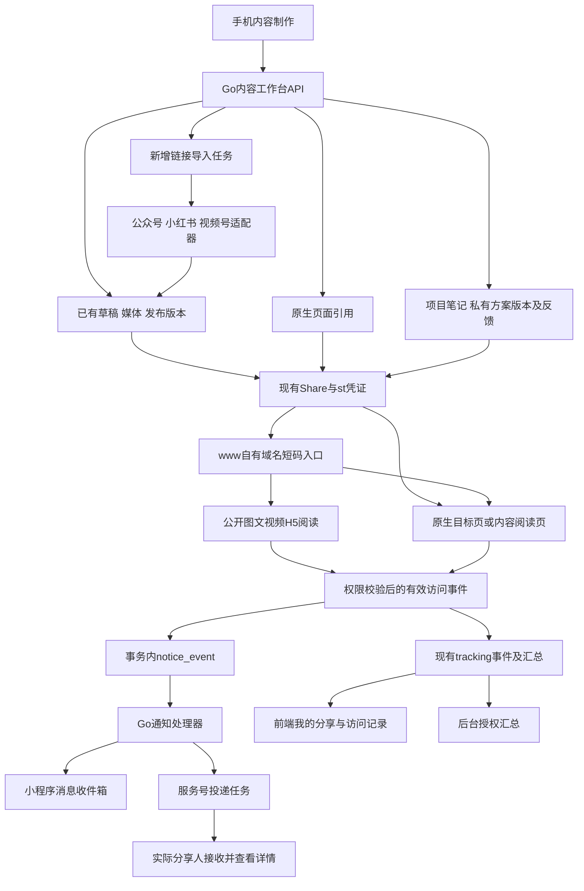

# 内容创作 分享追踪与服务号通知的现状对比及详细实现方案

本文依据本聊天最新确认的业务规则，对当前甲第小程序、Go服务、React后台和CRM相关代码重新核对。基线核对之后已开始授权开发，最新进度见文末及补漏验收记录。独立采集环境和其内部 Nginx 路由已部署，主业务未发布，未发送微信消息。此前生成的18个页面状态用于评审界面，不作为功能已完成的证据。

2026年10月27日更新：公网核对后，已通过用户右侧已登录宝塔实读www/API主配置、官网扩展与伪静态、Go项目登记及启动/环境文件；API上游为localhost:8080，线上基础跟踪开关均开启。分享页推荐接入既有`www.jiadilingguang.com/share/s/:code`，与原生卡片统一Share及实际分享人，候选Nginx配置已保存但未加载。后续已核实唯一PID3763918监听8080及启动环境：URL Link未启用、私有媒体目录未配，独立服务号凭据未见。账号名称确认为“华匠邦建科”；模板/关联/真实发送仍需核验。完整事实、接入契约和待核对项见[域名服务器核对与分享页接入方案](/Users/honor.pei/Documents/订单项目/甲地灵光二期/1024三期/需求整理/域名服务器核对与分享页接入方案_20261027.md)。

结论：复用现有内容草稿、媒体、发布版本、原生分享凭证及访问事件；新增手机创作和分享人工作台，补齐完整素材导入、私人笔记协作，以及由Go主服务负责的消息中心和服务号通知。不能把后台统计接口直接开放给所有小程序用户，也不能把CRM员工通知当作小程序消息中心。

## 一 范围及当前基线

### 已确认的业务规则

1. 以最新正式合同及附件为主，冲突逐条确认；2026年11月15日交付全部确认范围的可验收版本。
2. 内容包括已上传图片/视频、已有AI成果与模板作品、公众号正文图片、小红书图文/视频、视频号视频及项目笔记。三平台输入分享链接后完整导入，在甲第阅读/播放后再次分享。
3. 公众号导入要求保留原排版。不能把200字摘要、外链卡片或跳原平台当作完整导入完成。
4. 原生小程序页面可以作为内容引用，客户继续打开原生目标页，并使用统一分享参数进行追踪。
5. 私人笔记仅受邀且登录的账号可查看和反馈，转发不会增加权限。
6. 浏览后提醒实际分享人B；作者A、企业归属、客户负责人不能代替B。外部渠道采用服务号，消息中心同步留存，离开小程序也需收到。
7. 项目反馈、基础方案版本、原图下载和Word导出仍按合同保留，突出浏览提醒不代表删除原有交付项。
8. 前端查看访问记录、后台保留管理汇总，是本轮推荐结构；具体工作台导航排列仍可结合已有页面确认。
9. 原生卡片直接打开原生目标页；复制网址采用自有域名入口。图文/视频公开内容可在H5实际阅读/播放，原生业务页在目标小程序实际读取，私人笔记在小程序完成受邀登录校验。入口访问不等于已阅读目标内容。
10. 私人项目分享固定分享时的版本，更新后重新冻结并分享；设计师处理反馈，当前指定且受邀的业主确认方案，两个动作独立。

### 代码基线

- 主仓库：`/Users/honor.pei/Documents/订单项目/甲地灵光二期/开发版916/JDLG`；远程`phlong026/jdlg-development`；分支`main`；提交`73c36d8174fb5e446459468bb9cd692b902abd66`。10月26日初始核对时干净；10月27日开始核对时已有本聊天生成的未跟踪`docs/superpowers/`工程计划，不将其称为代码已提交。
- 嵌套CRM：`customer-management`；分支`master`；提交`7947152671868731553dd753215c07841dfbf184`。当前有700项既有工作区变化。本方案不覆盖、不提交这些既有修改。
- 主链：微信原生小程序 → Go API → 主库；React为管理后台。Java phase1承接正式CRM，三期客户档案继续复用，不重建CRM。
- 本轮核对是当前本地代码和离线基线检查，不代表线上迁移、功能开关、公众号权限、上游媒体服务已验证。

### 域名和服务器接入决策（2026-10-27）

| 现有入口 | 本次现场结果 | 三期使用方式 |
|---|---|---|
| api.jiadilingguang.com | 解析162.14.210.252，TLS有效至2027-01-21，后台200；现有分享候选路径301至/api | 保留小程序API/后台，不将当前重定向当作分享页 |
| www.jiadilingguang.com | 同一IP，TLS有效至2027-01-22，官网首页200、分享候选路径404 | 推荐增加/share/接收页和限定同源接口，保留官网首页 |
| static.jiadilingguang.com | CNAME到腾讯云COS，TLS有效至2026-12-10 | 保留公共资源；不公开私密媒体或正文 |
| share子域名/裸域名 | share查询NXDOMAIN；裸域名本次A记录为空 | 本期明确用www，不以新DNS/新证书为前置 |

复用现有www证书、域名和Go服务器，新增`service/shareweb/`网页模板及浏览器采集脚本，不新建服务器或独立React应用。官网root已实读为`/www/wwwroot/www.jiadilingguang.com`，主配置为`/www/server/panel/vhost/nginx/html_www.jiadilingguang.com.conf`。其现有extension目录拟新增phase3-share.conf，仅将/share/、share-web API及独立服务号回调交给已确认的localhost:8080，不将管理API映射给匿名网页。已保存[候选配置](/Users/honor.pei/Documents/订单项目/甲地灵光二期/1024三期/需求整理/部署候选配置/phase3-share.conf)，尚未上传、执行nginx -t或加载。

本机SSH认证失败后，用户打开了目标162.14.210.252的已登录宝塔，服务器入口阻塞已解除。API主配置location /返回301 /api，/api/代理localhost:8080；www伪静态只有注释，扩展仅有统计access_log。线上tracking/config返回enabled/content/video/intent均true。Go项目页“未启动”与公网API可用并存，不能据此启动第二进程；部署前需确认当前管理者。已读.env/.env.local未见媒体目录、trusted proxy、URL Link及新增服务号键，不等于进程继承环境一定未配置。微信后台仍受工具访问限制，未核验服务号模板/关联。本轮没有变更线上配置。

## 二 现有实现与修改后逐项对比

| 能力 | 当前实现 | 最新方案 | 改动与影响 |
|---|---|---|---|
| 内容入口 | 后台编辑、可分享素材列表和公开阅读页；手机素材列表需显式授权 | 手机统一内容制作、搜索分类、编辑及已有成果选择 | 新增前端业务页面及最小权限API，保留原后台 |
| 图片和视频 | 受控图片/MP4上传、媒体元信息、私有目录和受控读取 | 手机上传、查看、引用和分享，导入媒体也走统一存储 | 复用媒体服务；补手机上传和引用，不改为永久公开直链 |
| 公众号文章 | 配置公众号自身账号后批量同步已发布文章，生成草稿 | 输入文章链接逐篇导入并预览，保留正文/图片顺序和排版 | 新增URL导入器及正文格式；现有账号同步继续可用 |
| 原排版 | rich_text只保留少量标签，所有属性被清理；正文后单独排列媒体 | 图片、文字交错，安全的字号/段距/对齐/边框等排版映射 | 需新增有版本的文章结构和阅读渲染；仅改CSS无法完成 |
| 小红书和视频号 | 未发现完整平台导入器，已有通用上传和保存 | 分享链接解析到完整图文或可播放媒体 | 新增逐平台适配、异步任务、保存和失败处理；能力验证是关键依赖 |
| PDF/Word等资料 | tracking媒体仅PNG/JPEG/GIF/MP4，无通用文档上传预览 | 按合同首批管理确认的文档、提供原文件取得；Word导出独立完成 | 新增文件类型校验和下载权限，不能把现有媒体接口称为全格式资料库 |
| AI文案 | 已有Go流式AI和任务能力，内容保存本身不负责生成 | 设计说明、项目介绍、推广文案，可编辑回存 | 复用现有供应商/任务，补项目事实输入、结果保存与额度规则 |
| 业务项目与笔记 | AI历史、作品和公开内容，不具备完整业务项目/笔记语义 | 项目、笔记、方案版本、反馈、CRM引用 | 新增业务关联与私有权限；媒体、文本处理及公开作品底座复用 |
| 发布版本 | 草稿revision、预览凭证、发布version快照、撤回 | 保留现有公开版本；私人方案版本独立 | 老分享不改语义；不能把保存私人版本调用成公开发布 |
| 原生分享 | SDK已有st追加、好友path、朋友圈query、预热及失败回退 | 从内容制作选用原生内容，每次给当前分享人生成凭证 | 复用SDK；新增引用和入口。新页面注册采集，保留原业务参数 |
| 可复制小程序网址 | 现有后台URL Link仅面向已发布contentreader且受开关控制 | 手机操作者可为允许的目标创建自己的分享入口 | 新增手机授权路径；不能沿用管理员生成的链接却归因给销售B |
| 自有域名接收页 | www官网已存在，但/share/为404；小程序SDK依赖wx环境 | www/share/s/:code读取同一Share，公开图文视频H5展示，原生/私人目标进入小程序 | 新增Go模板、浏览器事件适配、受控媒体及同源路由；不复制一套内容/统计库 |
| 我的访问记录 | 后台按tenant/owner授权查询，无独立“我分享的”授权维度 | 手机按本账号实际发出的分享查询，管理后台继续汇总 | 增加sharer范围和索引/分页，不能把owner直接当作分享人 |
| 消息中心 | 小程序messagecenter只有空状态，无真实消息请求 | 浏览/反馈分类、未读、已读、详情和通知设置 | 新增Go消息收件箱和小程序页面逻辑 |
| 外部通知 | CRM有username收件人和企微投递；公众号代码负责文章同步 | Go用户ID收件人＋服务号发送＋消息中心留存 | 新增服务号身份、模板、发送/回执、重试；CRM保持自身通知 |
| 事件可靠性 | tracking事件、去重及汇总在现有事务中写入 | 同事务保留小型待通知事件，异步生成通知并投递 | 不在访问上报事务里调用微信，不延长租户锁持有时间 |

## 三 推荐整体结构

Go负责用户内容、追踪、消息及服务号的一致关联，Java CRM继续维护客户及跟进。只有明确关联的项目、客户和反馈通过现有桥接机制进入正式客户档案，不让浏览通知依赖CRM员工账号是否存在。

## 四 内容创作的具体实现

### 1 复用什么

现有`Content/Draft/Asset`继续承担一般内容、媒体和公开发布快照。`SaveContent → Preview → Publish`流程保留，编辑后revision递增，公开发布version递增。旧plain/rich_text和原读取参数保持可读。

主资料列表新增内容分类、创建者、业务关联和可见性元数据。企业owner继续表示归属，创建者与操作者另存，不复用owner表达个人身份。手机写接口只接受已授权的归属，不能因登录即可调用后台Manage权限。

### 2 原排版文章如何保存

已增加`body_format=article_v2`，Body保存版本化结构化文档，旧格式保持原样。文档按顺序保存段落、标题、图片、视频、列表、引用等块；原排版额外持久保存安全的`layout_html`，图片和视频只引用受控Asset ID。标签、属性和完整CSS值使用白名单，禁用脚本、事件属性和任意外部资源；H5二次清理，小程序将原生视频与闭合后的正文结构组合展示。原排版正文当前只读，保存标题或封面不会重建并丢失排版。AI三类文案仍需复用现有Go模型接入，补已知事实和缺失字段的约束、结果校验、人工编辑与草稿保存；调用和保存不等于公开发布，额度及失败重试沿用确认后的既有计费口径。

这解决当前“正文全部在前、配图全部在后”和样式被清除的问题。服务端先清理并归一，阅读端按文档顺序渲染；后台预览与手机阅读采用同一结构。原图比例、居中、字号、段距、分隔线等按确认的公众号样例逐项比较。不能以屏幕不同为由把统一排版替代原排版要求，也不承诺微信原站工具栏及所有脚本组件像素级复制。

先沿用当前正文长度和50个媒体引用的限制；一篇文章超限或有未取得图片时返回“未完整导入”及具体缺项，不静默截断后标记成功。若业务样例确需扩大限额，再针对序列化、查询预算及包体单独验证。

### 3 链接导入任务

新建`content_import_jobs`，字段含任务ID、tenant、owner、created_by、平台、规范化来源、幂等键、状态、进度、缺项、结果content_id、错误码、租约及时间。

当前实现状态：queued → resolving → downloading → ready；异常为failed、blocked、uncertain，只有允许的可恢复原因可重试。`ready`仅表示完整素材已保存为草稿，并非已公开发布。相同幂等键复用任务，变更请求语义会冲突；跨企业不泄露重复素材信息。结果不明的付费请求不会自动重新解析。

API接收链接后返回202及任务号。后台工作器执行网页/供应商请求、媒体取得及校验，外部请求均有超时、体积/类型限制和错误状态，网络处理不进入tracking租户锁事务。重启后通过租约恢复未完成任务，重复请求不会生成多份孤立内容。

三个适配器统一返回标题、来源、顺序化正文/图集/视频、来源标识及媒体清单，解析器不自行发布。公众号现有官方账号同步保留；任意URL逐篇导入是新增路径。视频号、小红书须先以真实输入证明完整输出，不能把接口名称、标题封面或外跳当作完成。

已存在的安全媒体抓取和上传服务优先复用。新增抓取按平台域名、每次跳转和实际连接地址校验，限制私网访问；不依赖用户手机常驻或桌面微信连接。临时直链取得后须验证持久保存和播放，不把地址暂时可用当长期素材可用。

### 4 原生页面作为内容引用

资料库保存`native_ref`，含允许的route_key、业务content_id、版本/快照ID、标题封面及来源关系。分享时调用当前用户的统一分享能力，目标仍为原生页面。

公开模板、作品和公开造价快照可优先接入。私人生成记录、付费报告、私人笔记必须使用已有或新增的访问授权，不把整个路由改成公开来省去鉴权。普通资料的来源URL不作为任意可跳转的小程序路径。

原生路径保留id等业务参数，SDK追加st；可复制URL Link在生成时把st写入小程序query。已有后台链接按管理员身份生成，手机B的新链接必须由B的认证上下文生成；不改写旧链接的历史归属。旧Share中console操作者与小程序账号不是已确认的同人关系时，不凭同名自动合并或发送服务号提醒。

### 5 项目笔记与方案版本

新增稳定业务项目、笔记关联、方案版本和反馈对象。媒体引用、通用文本清理、公开作品发布继续复用。

建议关系为项目 → 笔记 → 不可变方案版本 → 业主反馈/设计师回复；项目关联正式CRM客户。一个项目多本笔记、多人参与、谁可确认、分享锁定版本或最新版本尚需业务收口；设计中先保留关系，不用标题做连接键。

私人版本不写成公开published内容。新增项目授权校验接入读取、媒体、下载、分享创建、访问进入及事件接受路径；撤销后重新检查，原st不会授予权限。旧公开reader流程默认保留。Word和原图输出依据选定的方案版本，不带未授权客户电话或私密反馈。

## 五 分享追踪及前端访问记录

### 1 保留原生链路

继续使用SDK的`prepareShare`、`appendToken`、朋友圈预热、账号变化失效及失败回退。服务端Share保存Owner、Sharer、Parent、内容及版本，不让前端自报一个收件人决定通知归属。

完整链路为：内容引用/原生页面 → 为当前分享人创建Share → 卡片或URL Link携带st → 接收页读取原业务内容 → 有效entry及事件 → 前端记录 → 浏览通知。

自有域名出口为：www/share/s/:code → 服务器解析同一Share → 公开图文视频在H5读取，或使用同一Share的URL Link打开原生页。网页GET、封面预取和原生跳转入口不直接算成内容已读；通知由实际目标内可采集、可归因的有效事件产生。H5与小程序事件共用现有账本，浏览器端需新增适配器，不能直接复用wx专用SDK。跨端handoff保留事实并按规则去重，不按IP强行认人。

短码映射沿用Share有效期与撤回规则；URL Link生成/刷新绑定share_id，不再创建管理员分享覆盖B。当前URL Link与st均有有效期，自有域名不能让旧授权永久有效。公网www域名只增加限定路由；网页访问的凭证、内容读取和媒体下载仍在服务端校验，PUBLIC_SHARE_ORIGIN固定为配置值。

### 原生卡片能否达到黑谷同类跟踪效果

同一Share的URL Link及H5接口为拟新增契约，当前管理URL Link不能直接充当手机B的接口。正文、媒体和下载每次请求都检查Share、版本、撤回与访问授权，不以route或content_id单独放行。H5单独实现浏览器入口、可见性、播放、同意、重试去重及媒体错误状态，不能直接使用wx SDK和原生播放器观察器。

现有代码具备有效打开归因、部分页面可见停留和contentreader播放跟踪底座。完成手机分享人工作台、提醒触发、服务号绑定/发送及账号侧核验后，可形成“B分享—C打开—访问记录—提醒B”的目标闭环；当前尚未完成该闭环。黑谷服务端、完整H5及送达机制没有完整证据，不能把“同类业务效果”表述为所有细节相同。

| 情况 | 实际可实现的口径 |
|---|---|
| C打开B的有效卡片 | 归因到B的Share；匿名C不自动拥有真实昵称或手机号 |
| C打开后在甲第内再次分享给D | 取得新Share后保存Parent；登录C才有可核验的站内/服务号收件账号 |
| C在微信聊天直接转发B旧卡片给D | D仍可归到B入口，无法可靠识别中间转发人C |
| 页面停留和视频 | 统计已接入页面的可见停留；视频目前限contentreader有效绑定，新增播放器需接入 |
| Share生成、预热或share_intent | 只表示生成入口/发起分享，不表示送达、展示、收件人身份或已阅读 |
| 统计关闭/拒绝、凭证失效、准备失败回退 | 页面/分享可继续使用，但不能保证访问归因和提醒 |

聊天内所有转发者、未打开收件人和微信好友送达明细，不作为本期可验收承诺，也没有证据证明黑谷能自动取得。

若追踪预备失败，已有正常分享仍按当前策略可用，但要区分“可分享”和“本次可追踪”；不能在分享失败回退时仍宣称一定触发浏览提醒。朋友圈首开、缓存失效、账号切换和旧凭证到期均需回归。

当前SDK在分析未启用或用户未同意/已关闭采集时不进入访问事件链。因此，保留现有规则后，“有人浏览就提醒”指可合法采集、具备有效归因的访问，不能保证每一次打开都产生通知。读取和分享不因拒绝分析受阻；前端应区分浏览统计、已生成提醒、未绑定/未投递等状态，避免把未收到通知误判为无人查看。

### 2 前端“我的分享”新增安全边界

后台Scope.Owners表示数据归属，不表示当前分享人。前端从已认证user_id形成`u:<id>`，服务端先限定Sharer及tenant/owner，再查询这些分享对应的访问。前端不能传另一个sharer_id来扩大范围。

列表和详情均做该检查：分享列表、素材访客、访客时间线、消息跳转、导出及客户档案入口。某访客同时看过B和C的素材，B的页面只返回B有权查看的部分；不能从一条提醒获得该访客的全企业历史。

企业管理员仍按授权范围查询团队，平台后台不因此消失。原后台接口和权限默认保持，新增分享人筛选维度以增量方式接入。

### 3 查询与统计

优先使用既有游标、as_of、metric_version、summary及有界查询，不一次拉全量事件到手机。按tenant、实际分享人、时间、share_id建立或补齐索引投影；旧记录缺失投影时采用受限兼容查询和分批回填，不能把JSON全表扫描变成新前端热路径。

避免逐素材查询次数再逐访客查昵称，批量读取授权分享、汇总和必要身份；详情按需加载。访问人数按当前范围内访客去重，浏览次数可相加，发起转发不等于送达；视频有效观看和播放位置继续使用现有口径。

二次传播仅在产生新的可验证分享记录时保留Parent关系。直接沿用旧卡片或外部复制的链接，不凭昵称猜新转发者身份。

## 六 消息中心与服务号通知

### 1 小程序通知归Go主服务

新增Go通知收件箱，主键收件人为`users.id`，不使用CRM username。建议两张表：

| 表 | 关键字段与索引 |
|---|---|
| mini_notifications | id、tenant、owner、recipient_user_id、kind、event_key、share_id、visit_id、content/版本、只含必要信息的payload、read_at、created_at；唯一键tenant+recipient+event_key；分页索引tenant+recipient+created_at+id |
| mini_notification_deliveries | id、notice_id、channel=service_account、binding_id/版本、state、attempts、next_attempt_at、lease_until、provider_msg_id、last_error_code；唯一键notice_id+channel；工作索引state+next_attempt_at+id |

列表只按已认证收件人读；未读数、单条/批量已读与详情使用同一授权。已读只指甲第消息中心，不能把服务号接口受理或点击推断为微信消息已读。

### 2 事件到通知不能漏、不能阻塞浏览

当前`SQLStore.Transaction`已经持有同一tenant事务和租户行锁。方案是在有效浏览事件接受的同一Repository事务里，插入一条小型`kind=notice_event`记录，仅包含必要引用；不在这里下载、调用微信或循环查询所有客户。

该记录是可靠待处理事件：事务失败则访问事件和待通知事件一起回滚；事务成功后处理器分页领取。通知处理器在自己的短事务内幂等创建收件箱与delivery，再标记源事件已处理。若使用现有Store抽象，应提供明确适配方法，不能在Accept回调里另开独立SQL事务然后声称原子性。

唯一业务键和处理标记保证重放不产生多条中心消息。外部发送放在事务外，使用租约、防并发领取及有限重试。任务租约与下一次执行时间持久化，不能仅靠内存goroutine。外部接口恰好执行一次不能由本地唯一键保证。

### 3 服务号绑定及模板

建议用`official_account_bindings`保存app_id+openid与甲第user_id的一致绑定、关注/接收状态、绑定版本和更新时间，唯一键为服务号app_id+openid。绑定意图由当前登录账号发起，服务端一次性state绑定账号、有效期及回调；回调不接受任意user_id覆盖其他人的绑定。

UnionID仅在实际存在、平台关联和映射已核验时辅助关联，不假定必然可得。小程序openid不能直接作为服务号收件人openid。用户手机号、CRM username和服务号openid分别处理；旧手机绑定代码的覆盖写法不能未经审查复用于服务号绑定。

通知接收方设计师/销售需要完成服务号绑定和可接收条件；普通访客不应为了阅读而被迫关注服务号。未绑定、取消关注或不能接收时，中心记录仍保留，并显示明确状态及绑定入口。

模板ID、字段和消息场景以实际服务号后台可用能力核验；模板文案拟表达被查看内容、时间和可确认访客信息，缺昵称使用匿名文案。点击目标是已授权的访问详情，小程序与服务号配置及可跳转条件需真实验证。

本轮推荐服务号OAuth返回和消息回调均使用www域名的独立路径，具体见域名接入文档。既有TRACKING_MP_*仅代表文章同步；新增服务号身份/发送/回调配置分开管理。账号侧仅配置实际用到的网页授权域名、JS接口安全域名及校验文件；原生卡片不依赖web-view业务域名。服务号与小程序关联、模板是否允许浏览提醒、发送条件和出口IP白名单仍需现场核验；不能用客服48小时规则、群发或企微替代已选服务号方案，也不能因接口文档存在就保证目标模板可用。

### 4 状态及异常

| 状态 | 含义与处理 |
|---|---|
| queued/leased | 已排队/已领取；中心消息已存在，不代表外部送达 |
| accepted | 服务号接口已受理，保存provider_msg_id；不等于用户实际看到 |
| success_callback | 若该消息能力有可用成功回执则记录；最终验收还需收件手机实测 |
| blocked | 未绑定、未满足接收条件或模板不可用；保留中心消息与处理入口 |
| failed | 明确失败，按错误分类决定可否重试；记录错误码而不记录密钥 |
| unknown | 请求超时/断连且是否已受理不明；先核查回执或人工处理，不盲目高频重发 |
| cancelled | 绑定或授权撤销、隐私删除等导致不应继续发送，停止后续投递 |

已确认提醒实际分享人B。浏览去重窗口、匿名浏览是否外推、短时重复浏览如何聚合尚未确认，建议配置化；测试用固定窗口，不擅自把测试值当生产规则。作者自看、预览、无访问授权及重复上报不创建误导性的客户浏览通知。

## 七 拟新增API及跨模块契约

以下为设计中的新接口，不是已上线接口。统一使用现有TokenAuthRequired及封禁检查，写请求具备幂等键/版本冲突处理；actor和recipient来自服务端认证，客户端仅选择获授权owner。

| 接口 | 行为与关键返回 |
|---|---|
| GET /api/v1/miniprogram/workbench/context | 返回可用能力、允许的空间、内容类型和服务号绑定状态 |
| GET/POST /api/v1/miniprogram/workbench/contents | 本人/授权资料的游标列表与草稿保存；返回content_id、revision、状态 |
| POST /api/v1/miniprogram/workbench/imports | 提交platform、source_url、owner及幂等键；202返回job_id |
| GET /api/v1/miniprogram/workbench/imports/:id | 返回状态、缺项、进度及结果引用；只允许创建者或授权管理者 |
| POST /api/v1/miniprogram/workbench/native-references | 校验允许route、业务ID和可分享版本，保存来源引用 |
| POST /api/v1/miniprogram/workbench/contents/:id/share | 当前分享人创建追踪凭证及目标path/query；返回tracking_ready、share_id及到期时间 |
| POST /api/v1/miniprogram/workbench/share-entries | 原生/内容目标统一生成Share、native_path/query及www网页短码入口；旧contents/:id/share可委托该逻辑 |
| GET www域名/share/s/:code | 新网页接收页；分享失效、撤回及私有状态不泄露正文；GET不创建浏览通知 |
| POST www域名/api/v1/share-web/entry、events | 网页专用入口和事件适配，复用Enter/Accept与汇总；不开放管理权限 |
| GET www域名/api/v1/share-web/media/:id | 有效入口上下文及内容/媒体归属再校验，支持受控播放读取 |
| POST www域名/api/v1/share-web/open-miniprogram | 同Share生成/复用微信URL Link及可信handoff，不把B改成console管理员 |
| GET /api/v1/miniprogram/tracking/my-shares | 服务端锁定当前Sharer的素材/分享列表，游标分页 |
| GET /api/v1/miniprogram/tracking/my-shares/:id/visits | 该分享的获授权访问；包含snapshot和metric_version |
| GET /api/v1/miniprogram/notifications | 收件箱分页；另有unread-count及单条/批量已读接口 |
| GET/POST /api/v1/miniprogram/official-account/binding | 查看绑定/创建一次性绑定意图；解绑使用独立受保护动作 |
| GET/POST /api/v1/wechat/official/callback | 独立服务号回调入口，按消息/关注事件及发送回执分发；验签及解密不复用虚拟支付业务处理器 |
| GET www域名/api/v1/wechat/official/oauth/callback | 仅消费发起账号的一次性state，绑定服务号身份；不按任意user_id或昵称覆盖绑定 |

项目/笔记及反馈接口按业务对象独立组织，读写同一稳定项目编号；私人读取和下载不使用只验发布状态的公共reader接口。CRM跳转沿用正式customer_id及现有鉴权，没有相应客户权限时不展示可用的档案操作。

## 八 影响范围及兼容策略

| 影响位置 | 改动程度 | 兼容要求 |
|---|---|---|
| 小程序我的/工作台、app.json | 中 | 保留原菜单及四个Tab，按角色增加入口；消息中心隐私页面不成为公共分享页 |
| contentreader TS/WXML/WXSS及对应JS | 中高 | 按body_format分支支持article_v2；旧plain/rich_text仍原样；私有方案独立鉴权 |
| utils/tracking及routes | 高敏感 | 原业务query、标题封面、预热、账号/同意状态失效、失败回退保持；新增route明确声明 |
| tracking content/types/media/mp_sync | 中高 | 新类型可选字段及新格式增量加入，不重写旧发布快照；保留受控媒体访问 |
| tracking service/store/visits/query | 高敏感 | 增加sharer查询和小型待通知事件，保留事件不可变、租户隔离、查询预算及读写分离 |
| Go消息/服务号新模块 | 新增主体 | 与用户ID一致，不依赖CRM员工；可靠投递与隐私撤销同步 |
| React后台 | 中 | 旧接口继续工作；增加新正文预览、导入状态、通知失败及授权管理 |
| Java CRM | 尽量不动 | 仅复用正式客户引用和桥接，不改公海/90天保护/username通知体系 |
| 数据库与媒体存储 | 增量 | 新任务/消息/绑定表、必要投影索引和私有项目关联；不删除旧表字段或把私有媒体直接公开 |
| 运维 | 中 | 新平台来源配置、服务号配置、worker开关/并发、存储容量和告警；配置缺失明确显示不可用 |
| www分享网页及反向代理 | 新增主体 | 官网root/include、API代理8080及重定向已实读；候选配置未加载，发布前验证有效配置、唯一进程、原入口和ACME |

存量处理：旧分享、发布版本和公开造价快照保持原标识；不批量把AI历史变成项目，不凭名字/昵称合并客户，不替旧分享重新猜实际分享人。通知默认从新功能启用后的有效事件开始，历史浏览不全量补推。媒体一旦经授权发布到公开作品，不能因同文件还被私人笔记引用就认定它仍私密；公开发布须明确选定素材，私人反馈和客户信息不得随资产引用一并公开。

升级采用新增表/字段 → 小范围试点 → 元数据分批回填 → 再启用新入口。回退先关新入口及worker，恢复旧读写路径并保留新数据；已发送的外部通知无法撤回，数据库down脚本不能当作撤回外部消息。私人授权撤销仍需由服务端执行，不能因回退而让私有内容公开。

## 九 开发分解和推进顺序

| 增量 | 可独立验收的结果 | 前置依赖 |
|---|---|---|
| 0 平台能力及规则收口 | 三平台样例、公众号原排版基准、服务号可用模板/绑定路径、角色和统计范围清楚 | 账号后台能力和业务样例；不等全部页面写完再验证 |
| 1 手机资料工作台 | 授权用户上传/选择已有资料、草稿保存、再打开；未授权账号无法读写 | 内容权限及归属确定 |
| 2 原排版与三平台导入 | 每平台完成链接到完整草稿、媒体读取和预览；异常可恢复 | 增量0能力验证，资料/媒体底座 |
| 3 原生引用与统一分享 | 原生模板/作品/造价快照及新内容都能由当前B分享并带st | 目标范围、业务版本、SDK契约 |
| 3A 自有域名接收页 | www/share/公开图文视频可读可播，原生目标可打开，同Share、有效期及跨端关联正确 | 服务器内路由核对、统一分享契约、H5事件适配及平台配置 |
| 4 前端访问记录 | 本人分享/素材访客/访问详情，后台授权汇总不受影响 | share维度查询与索引 |
| 5 可靠消息闭环 | 有效浏览生成中心消息，服务号提醒B，点击到相应记录 | 服务号绑定、通知事件与投递任务 |
| 6 笔记协作及整体验收 | 私人方案版本、反馈、修改、下载导出及CRM关联；至少3真实项目 | 项目关系、角色、授权及前述通用链路 |

增量1/2和服务号绑定可以分工并行准备，共用ID、归属和通知契约先冻结；追踪和通知事件落库的关键文件由同一负责人整合，避免多人同时改Accept。平台验证必须前置，不把供应商不确定性留到交付前。

以上是三个模块的依赖顺序，不是整份三期合同的工作量承诺。装修造价、AI原比例/参考强度等还共享同一截止日。11月15日仍按全确认范围要求安排，需将联调、真机和整改计入排期，不能用旧6.5周估算证明20天足够，也不能未经确认自动延期某个合同项。

## 十 验证矩阵

| 场景 | 关键断言 |
|---|---|
| 作者A、分享人B、访问者C | 记录三种身份，提醒B；客户负责人及企业归属不被改写 |
| B和D同属一个企业owner | B无法通过参数或访客详情读D独有分享，管理员按授权可看团队 |
| 原生好友/朋友圈/URL Link | 原业务ID及版本正确，st可解析；准备失败保持普通分享但不假报已可追踪 |
| 原生卡片直接转发与打开后重分享 | 旧卡片保留原来源，新Share才有新Sharer/Parent，不臆测中间人或送达 |
| www H5/小程序交接 | 官网仍200；内容可读可播，短码对应同Share，封面抓取不提醒，交接不重复外推，不按IP认人 |
| 原排版文章 | 图文交错顺序、标题、引用及选定样式对照样例；漏图/超限不可标记完整成功 |
| 图片与视频上传/导入 | MIME、大小、尺寸、权限正确；文件可实际读取，视频可在手机播放 |
| 私人笔记转发/撤销 | 未受邀账号无法读正文、下载或反馈；撤销后旧入口失效 |
| 事件重复/服务重启 | 同事件及确定窗口内按规则幂等，中心和发送队列不丢；重启恢复租约 |
| 外部超时/明确失败 | 区分unknown和failed；不重扣、不盲目重复发；浏览及中心记录仍可读 |
| 服务号未绑定/取消关注 | 不错投其他账号，中心状态可见；绑定后是否补发按确认规则执行 |
| 历史内容与后台 | 旧快照、老链接、CRM、公海与既有后台查询口径回归 |
| 撤回/隐私删除 | 新消息及投递任务纳入撤销和删除范围；无授权时消息详情脱敏并禁止跳转 |

### 本轮离线基线检查

以下测试结果来自10月26日的代码核对；10月27日仅更新文档并进行公网只读检查，没有把旧测试重新表述为新功能验收。

- 小程序`npm run test:tracking`：267项通过，0失败。
- 管理后台`npm run check`：类型检查及路由一致性通过，33条路由、157处跳转、153处样式范围、65个导航条目。
- Go `go test ./tracking ./route`：tracking通过；route在测试执行前由go-m1cpu的CGO初始化触发SIGSEGV，属于本机原生依赖初始化问题，未据此认定业务断言失败。改用`CGO_ENABLED=0 go test ./tracking ./route`后两包均通过；默认CGO路径的环境限制仍保留，不将纯Go通过表述为全部构建模式通过。
- 没有操作正式服务号、没有平台导入实测，没有真实分享/通知送达验收。本轮检查不能替代这些验收。

实施后的检查命令及先写失败测试的任务见[工程实施计划](/Users/honor.pei/Documents/订单项目/甲地灵光二期/开发版916/JDLG/docs/superpowers/plans/2026-10-26-phase3-content-tracking-notifications.md)。

## 十一 关键代码证据

| 编号 | 当前实现 |
|---|---|
| E01 | [内容/草稿/媒体/分享字段](/Users/honor.pei/Documents/订单项目/甲地灵光二期/开发版916/JDLG/service/tracking/types.go:104) |
| E02 | [草稿保存](/Users/honor.pei/Documents/订单项目/甲地灵光二期/开发版916/JDLG/service/tracking/content.go:25)及[发布版本](/Users/honor.pei/Documents/订单项目/甲地灵光二期/开发版916/JDLG/service/tracking/content.go:128) |
| E03 | [富文本清理](/Users/honor.pei/Documents/订单项目/甲地灵光二期/开发版916/JDLG/service/tracking/richtext.go:13)及[正文后排列媒体](/Users/honor.pei/Documents/订单项目/甲地灵光二期/开发版916/JDLG/miniprogram/miniprogram/pages/contentreader/contentreader.wxml:14) |
| E04 | [公众号官方文章源](/Users/honor.pei/Documents/订单项目/甲地灵光二期/开发版916/JDLG/service/tracking/mp_source.go:28)及[同步草稿](/Users/honor.pei/Documents/订单项目/甲地灵光二期/开发版916/JDLG/service/tracking/mp_sync.go:143) |
| E05 | [媒体上传限额](/Users/honor.pei/Documents/订单项目/甲地灵光二期/开发版916/JDLG/service/route/share_tracking_media.go:29)及[公开媒体引用检查](/Users/honor.pei/Documents/订单项目/甲地灵光二期/开发版916/JDLG/service/tracking/media_access.go:15) |
| E06 | [小程序素材独立授权](/Users/honor.pei/Documents/订单项目/甲地灵光二期/开发版916/JDLG/service/route/share_tracking_materials.go:16)及[后台归属授权](/Users/honor.pei/Documents/订单项目/甲地灵光二期/开发版916/JDLG/service/route/share_tracking.go:74) |
| E07 | [SDK参数准备](/Users/honor.pei/Documents/订单项目/甲地灵光二期/开发版916/JDLG/miniprogram/miniprogram/utils/tracking/index.ts:112)及[好友/朋友圈包装](/Users/honor.pei/Documents/订单项目/甲地灵光二期/开发版916/JDLG/miniprogram/miniprogram/utils/tracking/index.ts:320) |
| E08 | [服务端实际分享人](/Users/honor.pei/Documents/订单项目/甲地灵光二期/开发版916/JDLG/service/tracking/service.go:271)及[访问事件事务](/Users/honor.pei/Documents/订单项目/甲地灵光二期/开发版916/JDLG/service/tracking/service.go:516) |
| E09 | [现有后台URL Link范围](/Users/honor.pei/Documents/订单项目/甲地灵光二期/开发版916/JDLG/service/route/share_tracking_urllink.go:46) |
| E10 | [现有owner范围访问查询](/Users/honor.pei/Documents/订单项目/甲地灵光二期/开发版916/JDLG/service/tracking/visits.go:141)及[分享人元数据](/Users/honor.pei/Documents/订单项目/甲地灵光二期/开发版916/JDLG/service/tracking/visits.go:563) |
| E11 | [事务存储和租户锁](/Users/honor.pei/Documents/订单项目/甲地灵光二期/开发版916/JDLG/service/tracking/store.go:103)及[当前索引](/Users/honor.pei/Documents/订单项目/甲地灵光二期/开发版916/JDLG/service/sql/share_tracking_up.sql:17) |
| E12 | [小程序消息中心空壳](/Users/honor.pei/Documents/订单项目/甲地灵光二期/开发版916/JDLG/miniprogram/miniprogram/pages/messagecenter/messagecenter.ts:1) |
| E13 | [当前通用身份表](/Users/honor.pei/Documents/订单项目/甲地灵光二期/开发版916/JDLG/service/model/user_identity.go:9)及[小程序登录识别](/Users/honor.pei/Documents/订单项目/甲地灵光二期/开发版916/JDLG/service/processor/wechat_auth.go:79) |
| E14 | [微信HTTP/token客户端](/Users/honor.pei/Documents/订单项目/甲地灵光二期/开发版916/JDLG/service/tracking/wechat_api.go:28) |
| E15 | [CRM username通知](/Users/honor.pei/Documents/订单项目/甲地灵光二期/开发版916/JDLG/customer-management/phase1/src/main/java/cn/iyque/phase1/WorkflowController.java:17)及[现有企微异步模式](/Users/honor.pei/Documents/订单项目/甲地灵光二期/开发版916/JDLG/customer-management/phase1/src/main/java/cn/iyque/phase1/WecomNotifications.java:25) |

黑谷原始客户端对照及公众号原格式证据另见[黑谷实现对照](/Users/honor.pei/Documents/订单项目/甲地灵光二期/1024三期/需求整理/三期核心模块_黑谷实现对照与落地方案_20261026.md)。页面方案见[6组18页说明](/Users/honor.pei/Documents/订单项目/甲地灵光二期/1024三期/设计方案/内容创作分享通知-20261026/页面方案与现有能力复用说明.md)。

## 2026-10-27 首批开发进度

已在隔离分支feat/phase3-content-sharing实施内容工作台与article_v2阅读、本人分享/访问记录、同Share域名入口、消息中心及服务号投递基础。当前为本地开发/审查状态，生产未变更。完整配置/复用新增清单和后续增量见[首批开发说明](/Users/honor.pei/Documents/订单项目/甲地灵光二期/开发版916/.worktrees/phase3-content-sharing/docs/phase3/README.md)。三平台完整导入、私人项目协作、跨端handoff及真实服务号/真机验收尚未完成，仍保留在总范围。

## 2026-10-27 原排版、图集与COS补齐

已补齐安全原排版持久保存与三端阅读、小红书公开图文适配、私有COS写入/授权范围流读取及待完成对象恢复记录。隔离MySQL的任务到消息中心链路、原服务器COS真实读写均通过；公众号样例仍被风控、小红书样例当前公开页不含完整详情，指定新链接及测试接收账号由用户后期补充。服务号真实发送、URL Link、真机原生卡片及复杂排版仍待验收。具体配置、证据及提交见[补齐与真实联调记录](completion-and-live-verification-20261027.md)。

## 2026-10-27 采集部署与业务补漏

独立公众号采集环境已在原服务器部署，通过实际网络隔离、renderer sandbox、本机 HTTPS、浏览器重启恢复及外部拒绝访问检查。主服务尚未加载新增客户端和配置，真实含视频文章仍待用户后期补充样例，不能将环境就绪算作来源导入验收。

本地已补入 H5 视频可见播放与区间指标、离线重试和离页批量发送；私人项目已实现受邀账号、固定版本、项目独立媒体、设计师反馈处理、指定业主唯一确认及浏览消息。私人权限和前端均通过独立复审，并已通过隔离 MySQL 持久化回归。当前代码和生产状态分开记录；资料库 native_ref、跨端可信 handoff、CRM 关联与 Word 导出仍是开发项。详见[采集部署与三模块补漏验收](capture-and-module-audit-20261027.md)和[私人项目接口](private-project-notes.md)。
