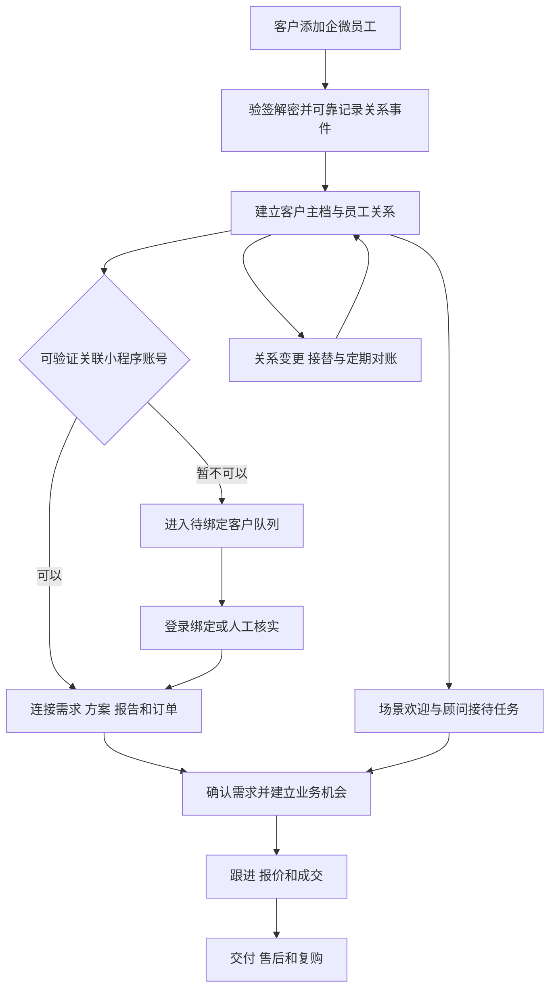

# 小程序企微新增客户全流程与客户管理系统选型分析

> 本文讨论的是长期深度绑定方案。第一期范围现已调整为企微加客后的独立客户管理；当前建议以[第一期简化方案](<E:/other​/jd/docs/wecom-customer-management-phase1.md>)为准。

建议在现有小程序业务系统上增量自研客户管理模块，以企微官方客户联系能力连接客户关系，以现有业务数据库管理客户身份、建房需求、生成方案、订单和报告交付。开源企微 SCRM 适合作为运营能力的可选补充；现阶段直接引入通用 CRM 作为业务主系统，收益不足以抵消身份整合、数据同步和额外技术栈的成本。

这个判断基于已明确的“长期与小程序业务深度打通”优先级，以及当前代码已经存在的线索与报告交付基础。若没有稳定研发维护能力，或者近期必须上线大量社群、素材、群发和会话运营功能，企微 SCRM 二次开发可能更优。这里的自研指围绕现有业务补齐闭环，并不意味着开发通用 CRM 的全部功能。

分析基准为 2026 年 9 月 10 日可读取的工作区代码及公开项目资料。未连接生产数据库或企微管理后台，未部署候选开源系统，因此以下严格区分源码事实、产品方公开声明、架构建议和工作量估算。客户量、顾问人数、团队能力与预算尚未确定，不能据此给出实际漏单率或承诺上线日期。

## 一 现有业务已经具备的基础

从代码看，业务围绕建房需求采集、风格选择、AI 方案生成、造价分析、完整建房报告、设计顾问承接展开；同时有充值、会员、设计师等模块。因此，客户管理应服务于持续的建房咨询和业务转化，不能仅停留在通讯录管理。

技术基础是 Go 服务端、React 管理后台、TypeScript 微信小程序。现有客服线索包含用户 ID、需求摘要、房屋层数、风格、地块宽深、房间要求、来源、会话号、生成任务号、意向等级、负责人和下次跟进时间。这些业务字段和关联关系，是继续建设的直接基础。[客户线索模型](<E:/other​/jd/service/model/customer_service.go:25>)；[现有管理工作台](<E:/other​/jd/background/src/pages/customerLeads.tsx:142>)。

| 现有模块 | 已有能力 | 对新增企微客户管理的意义 |
|---|---|---|
| 小程序智能客服 | 收集结构化建房需求，记录关键行为，创建或更新线索 | 顾问可以承接客户已经表达的需求 |
| 客户线索工作台 | 新线索、已联系、已成交、无效；高意向、超时、未分配等队列 | 可增量演进为顾问工作台 |
| 跟进记录 | 负责人、下次跟进时间、备注、操作人 | 有基本协作记录，无需重新搭建全部后台 |
| 业务事件 | 会话、来源、任务、需求摘要和扩展数据 | 能构建客户行为时间线 |
| 报告企微交付 | 官方协议回调、带 state 的联系我二维码、UnionID 校验、欢迎消息状态 | 可以复用其严格的身份校验思路 |
| 用户、订单及报告 | 用户身份、支付状态、报告生成和下载权限 | 客户管理可以直接关联真实业务结果 |

源码存在这些能力，不代表生产环境已全部启用，也不代表它们目前已经自动串联。

## 二 当前实际存在三条不同的承接路径

### 1 智能客服转人工路径

当前路径为：需求采集 → 创建或更新线索 → 记录转人工事件 → 调用 `wx.openCustomerServiceChat` 打开微信客服会话。

`handoffHuman()` 会先尝试创建线索，再打开客服；生成方案按钮也会尝试静默创建线索。因而现有线索池并不是企微好友池，其中包含尚未加好友、甚至尚未真正联系顾问的用户。没有登录 token 时，创建线索函数会提前返回，转人工函数仍可能继续打开客服。[生成和转人工处理](<E:/other​/jd/miniprogram/miniprogram/pages/customerservice/customerservice.ts:741>)；[线索提交](<E:/other​/jd/miniprogram/miniprogram/pages/customerservice/customerservice.ts:807>)。

关键区别：打开微信客服、点击“联系服务商”和成功添加企业员工好友，是三个不同事件。现有封装虽然命名为企微客服，其成功返回只代表 `openCustomerServiceChat` 调用成功，不能用来确认客户联系好友关系。[客服入口实现](<E:/other​/jd/miniprogram/miniprogram/utils/enterpriseWechat.ts:102>)。

建议保留微信客服承担即时咨询，同时单独设计“添加专属顾问”入口。前者统计客服承接，后者以经校验的客户联系事件或关系查询结果统计加客。

### 2 图片下载与手机号验证路径

当前 `/user/ai/wecom/verify-phone` 使用小程序手机号授权 code 换取手机号后，直接调用 `SetEnterpriseWechatVerification(..., true, contact)`；并可能将绑定票据标记为 verified。它没有在该路径证明用户已经添加员工好友。[手机号验证接口](<E:/other​/jd/service/route/miniprogram.go:3395>)。

因此 `enterprise_wechat_verified=true` 在这些流程中实际承载了手机号授权状态。后台还存在人工设置入口，历史数据不能直接当成已加企微客户。[后台设置入口](<E:/other​/jd/service/route/management.go:318>)。

另一个 `/wecom/enterprise-wechat/callback` 接收自定义 HMAC 签名和 JSON 票据数据，属于自定义桥接协议。报告模块的回调则处理企微加密 XML。两者不能不经适配便视为同一种官方事件入口。[旧桥接回调](<E:/other​/jd/service/route/miniprogram.go:1431>)；[报告官方协议回调](<E:/other​/jd/service/reportwecom/callback.go:15>)。

旧二维码生成函数只是给 URL 追加 `ticket` 参数。如果该 URL 指向静态二维码图片，改变图片 URL 的查询参数并不会改变二维码内编码的内容。它是否能传递渠道或用户上下文，取决于是否另有动态生成或桥接服务；仅凭当前函数不能证明这条归因链路成立。[二维码 URL 处理](<E:/other​/jd/service/route/miniprogram.go:1171>)。

### 3 付费建房报告的企微交付路径

这条路径更完整：校验报告归属及有效支付 → 获取用户 UnionID → 建立带随机 state 的票据 → 调用企微“联系我”接口生成二维码 → 接收添加客户回调 → 拉取客户详情并核对 UnionID 和跟进员工 → 绑定报告 → 尝试发送欢迎消息 → 用户回到小程序读取报告。

它有几项值得保留的设计：

- 校验 UnionID 相等，而不是只判断存在；state 单独不能授予报告权限。
- 同时校验真实跟进员工，避免把企微员工 ID 与小程序用户 ID 混淆。
- 欢迎消息使用条件领取状态，避免重复回调直接重复发送；超时或结果不确定时进入 `manual_required`。
- 完整报告下载同时检查已支付、已绑定、已生成，手机号验证不能替代真实联系人绑定。

依据：[票据与身份校验](<E:/other​/jd/service/reportwecom/service.go:37>)；[添加客户事件处理](<E:/other​/jd/service/reportwecom/service.go:117>)；[报告支付和身份](<E:/other​/jd/service/route/report.go:192>)；[下载条件](<E:/other​/jd/service/report/service.go:159>)。

但它是报告交付专用能力：依赖报告票据、支付状态、单个配置员工及非空 state；只处理 `add_external_contact`。从当前调用关系看，它不会顺便创建通用客户档案或线索，不能覆盖普通加好友、没有小程序账号的客户、多人跟进和完整客户关系生命周期。客户先前已经加过员工、之后再买报告时，也需要独立验证已有关系的路径，不能期待每次都收到新的加好友回调。

## 三 当前最影响有效管理的缺口

| 优先级 | 源码依据与发现 | 业务影响 | 建议 |
|---|---|---|---|
| P0 | 手机号验证可以写入企微验证标记 | 无法准确回答新增了多少真实企微客户 | 拆分手机号、好友关系、账号绑定和业务权益状态 |
| P0 | 通用线索创建来自小程序提交；报告回调没有通用建档调用 | 直接添加员工的客户可能进不了工作台 | 所有有效加客事件先进入独立客户主档 |
| P0 | 报告流程依赖 paid、state、UnionID 和单员工 | 非报告客户、未绑定客户难以被统一管理 | 通用事件接收与报告授权分开处理 |
| P0 | `assigned_to` 为文本，后台自由输入姓名 | 无法可靠关联企微员工、执行分配及离职交接 | 员工主档加明确的负责人 ID，保留关系历史 |
| P1 | 客户线索含任务和会话，但没有独立的客户及多项目模型 | 同一人多地块、多次咨询容易被合并到同一开放线索 | 一客户多需求项目，多项目各自跟进 |
| P1 | 当前漏斗前段按会话去重，成交按线索计数 | 结果不是严格的企微加客到成交漏斗 | 同一加客批次、同一客户口径、明确转化窗口 |
| P1 | 超时队列按下次跟进时间或记录更新时间判断 | 改备注可能掩盖未联系；新建未排期可能即被视为超时 | 用实际首次跟进、有效跟进和应办任务时间计算 SLA |
| P1 | 已读取的通用路径未见删客、接替与周期对账闭环 | 客户关系和实际可触达性可能逐步偏离 | 关系事件处理、定期同步、异常队列 |

依据：[线索负责人输入](<E:/other​/jd/background/src/pages/customerLeads.tsx:651>)；[按用户查找开放线索](<E:/other​/jd/service/model/customer_service.go:426>)；[当前超时定义](<E:/other​/jd/service/model/customer_service.go:908>)；[当前漏斗实现](<E:/other​/jd/service/model/customer_service.go:936>)。

现有查询允许通过参数筛选负责人，但筛选条件本身不是权限控制。推广给多名顾问前，应在服务端建立“本人、所属团队、主管”的数据范围；当前已读取的线索查询没有按当前操作者自动收窄记录范围。这是扩展需求，不据此推断现网未授权访问已经发生。[线索查询接口](<E:/other​/jd/service/route/customer_service.go:236>)。

## 四 建议的完整客户生命周期

图中是拟建流程，非现有系统全部已实现。身份关联、欢迎接待和业务数据补全可并行推进；身份暂缺不应阻止客户建档。

### 阶段 1 客户来源与加好友确认

入口应覆盖小程序智能客服、生成方案详情、造价结果、报告交付、设计师页面，以及员工名片、线下二维码和转介绍。每个入口记录场景和活动，必要时记录任务或报告引用。

通过“联系我”等获准入口传递短随机 state，在服务端映射完整上下文。state 用于归因，不包含手机号、订单凭证等敏感信息，不直接作为身份认证凭据。没有 state 的有效加客也要入库，来源标为未知并允许后补；二维码被他人转发时，不能把扫码者自动绑定为原始小程序用户。

分别记录“入口展示、入口点击、确认新增关系”。客户已经是好友时，点击旧码通常不能作为新增统计证据；业务入口回访与好友新增必须分开。

### 阶段 2 建档与客户去重

首先创建不依赖小程序账号的内部 `customer_id`，保存企微标识及员工关系，再尝试匹配 `user_id`。以标识的有效命名空间去重，而不是手机号、昵称或头像。企微标识应保存 corp 和调用方命名空间；由第三方系统迁移到自建应用时，要先验证标识是否可直接对应，必要时使用支持的转换和映射。

同一个客户添加两位顾问，形成一个客户、两条员工关系；删除后重加，保留多个关系期间。管理报表至少区分“企业首次新增客户”“员工新增关系”“老客重新添加”，否则会高估获客。

有明确需求才创建业务机会；仅加好友的客户先进入待了解需求池。一个客户咨询两块地、两个建房项目，应创建两个机会，不应覆盖此前需求。当前以最近开放线索兜底合并的逻辑，需要迁移为显式项目关联。

### 阶段 3 小程序身份关联

优先使用配置条件满足且处于可比身份体系内的 UnionID，核对小程序账号与企微联系人确实一致。OpenID 必须连同 AppID 使用；微信客服标识和客户联系标识也不能仅因名称相似直接等同。

UnionID 缺失时，先保留客户，再使用登录后的绑定流程或人工核实。若使用从企微发送的短期绑定入口，应绑定联系人、用途、有效期和一次性消费状态；对敏感业务还要验证账号归属与已有证据，不能仅凭可转发链接完成高权限绑定。

手机号仅作为辅助匹配线索。用户授权手机号证明的是该次手机号授权结果，不自动证明好友身份；共享电话、变更电话和账号合并冲突进入人工处理队列。保存关联来源、验证时间与撤销记录。

建议拆分四种状态：`phone_verified` 表示手机号验证；`relationship_status` 表示企微关系；`identity_link_status` 表示业务账号关联；订单与报告保留各自的支付及交付权限。切换状态模型时保留原有下载业务规则，另行决定是否调整产品门槛，避免修正统计时误伤用户权益。

### 阶段 4 欢迎与首次接待

按真实入口设置欢迎内容：报告领取提供本人交付入口；方案咨询承接已选风格和地块条件；造价咨询提示补充地域、面积和预算；设计师或合作方进入不同业务队列。客户信息未经核验时，不在欢迎内容中暴露其付费报告或私有业务资料。

欢迎发送走轻量、优先处理路径，预先准备素材，不等待 AI 总结或批量同步。现有报告代码以事件时间 18 秒作为内部保守阈值，这属于源码事实；平台最新有效窗口、欢迎码返回条件和使用次数，需要上线前在企业可访问的官方文档和测试账号中复核。不能将当前代码阈值宣传为已核验的平台最新规则。[现有欢迎消息处理](<E:/other​/jd/service/reportwecom/service.go:146>)。

把发送结果区分为成功、明确失败、结果未知、无法发送。结果未知不盲目重发，生成顾问补发任务，并让客户在小程序交付中心继续查看状态。欢迎语发送成功也不等于客户已阅读、已被人工服务。

### 阶段 5 分配负责人和响应时效

默认以实际加到的企微员工为服务关系人；商业机会可有明确的主负责人和协作人。小程序分配规则优先保留已有有效关系，再考虑业务类型、顾问能力、地区、值班和负荷。修改 CRM 负责人不等于完成企微好友关系接替，两件事要分别记录和确认。

可试行以下运营标准：营业时段高意向客户 15 分钟内首次人工跟进，普通客户 2 小时内，非营业时段进入次日值班队列。它们是供试点调整的业务目标，不是平台限制或当前绩效事实。

每次跟进至少记录结果、下一步和应办时间。超时后提醒员工，持续超时再提醒主管；“联系失败”“等待客户资料”“客户希望暂缓”要有不同原因，不能统一填成已联系。未接入会话存档时，用顾问记录和内部任务完成作为可观察证据，不假称能自动知道所有聊天内容。

### 阶段 6 需求画像和意向判断

客户页集中展示地块尺寸、层数、风格、房间要求、预算区间、拟建时间、生成方案、报告状态和最近业务行为。标明信息来自客户填写、业务事件还是顾问确认，并保留更新时间。

当前意向分析是规则评分，包括留下联系方式、关联生成任务、需求完整度和关键词，并会参考前端等级；不能把它当作经成交数据校准的预测概率。[现有评分](<E:/other​/jd/service/model/customer_service.go:350>)。

第一期保持可解释规则，区分报告付费用户、请求人工定制用户、仅体验生成用户和设计师合作方。客户主动要求联系、已提供地块信息、短期建房计划可以提高优先级；单次浏览和为下载而授权手机号不应自动判断为高价值成交机会。

### 阶段 7 成交与交付

建议机会阶段为待确认需求、有效需求、方案沟通、报价、成交、暂缓、流失；交付状态另行管理。原来的四态可以保留兼容展示，但不能承担所有销售和交付语义。

报告购买、会员充值、模板购买和人工设计合同，应分别统计。付费报告不等于人工设计成交；如人工设计签约目前在线下完成，需要补充合同或收款确认及其证据，不能把“顾问标记已成交”直接作为收入事实。

支付、退款和报告完成由现有业务系统提供可信事件，更新客户时间线与待办；CRM 不另造一份相互竞争的订单台账。建立“已支付待绑定、已绑定待生成、已生成待领取、交付失败、退款处理中”等可执行队列。

报告交付访问权、历史已验证身份和当前好友关系分别建模。客户后来删除员工，不应由 CRM 擅自撤销已购买内容；权益处理必须服从产品约定与订单规则。

### 阶段 8 售后 留存和关系变更

已购报告客户进入报告理解与后续设计咨询；人工设计客户进入项目交付与售后。触达遵守客户意愿，记录不再营销、暂缓联系和投诉状态，不将删好友简单视为销售失败。

覆盖客户删除成员、成员删除客户、员工离职、在职转接和接替结果；保留历史负责人、当前服务关系和客户既有业务记录。定期在应用可见范围内核对客户列表及关系详情，处理回调丢失、重复和顺序变化。

企微接口、权限和产品规则对自研及开源方案都构成约束。客户联系事件不是完整聊天记录；如确有会话质量分析需求，应单独确认会话存档开通、授权、客户同意、数据保留和费用条件。群发任务也不能按“创建任务即所有客户已收到”统计。腾讯云公开的企微互动资料同样把客户画像、员工任务、会话分析作为不同能力介绍。[腾讯云产品概述](https://cloud.tencent.com/document/product/1739/100912)；[腾讯云应用场景](https://cloud.tencent.com/document/product/1739/100914)。

## 五 推荐的数据和系统边界

### 1 最小数据模型

| 数据对象 | 主要职责 | 必须避免的问题 |
|---|---|---|
| 客户主档 customers | 内部 customer_id、客户类型、创建来源 | 强制要求已有小程序账号，导致线下新客无法入库 |
| 客户身份 customer_identities | user_id、企微标识、UnionID 等及其命名空间和验证证据 | 用手机号或 state 直接合并身份 |
| 员工关系 wecom_relationships | 员工 ID、客户 ID、添加和删除时间、状态、关系期间 | 多员工关系相互覆盖；重加无法保留历史 |
| 入口记录 acquisition_contexts | state、渠道、活动、业务引用、有效期 | QR 图片 URL 参数与码内上下文混淆 |
| 建房机会 opportunities | 一个具体需求项目、阶段、负责人、预计金额 | 一客户所有咨询共用一个线索 |
| 跟进及任务 | 跟进事实、结果、下一步、SLA、操作人 | 更新备注就重置联系时钟 |
| 事件收件箱与发件箱 | 原始事件引用、处理状态、重试和下游投递 | 接收成功后进程崩溃，事件永远丢失 |
| 业务关联和审计 | 任务、报告、订单、权限、身份合并历史 | CRM 与订单系统互相覆盖权威状态 |

第一期可以在现有数据库增量建表，逐步迁移线索，并保留旧 ID 映射。没有必要一开始部署复杂微服务或大型消息平台；可以从数据库收件箱、事务发件箱和后台任务处理开始。

### 2 统一企微接入

建议建立统一的企微事件接入和分发模块，复用已存在的验签、解密、接口调用思路，同时解耦报告业务。

通用接入负责关系事实和可靠接收；身份模块负责账号关联；报告模块独立判断付款和领取资格；工作台负责分配及跟进。如果以后接入开源 SCRM，应定义唯一的事件处理与欢迎发送责任方，在受支持的回调配置下进行内部事件分发，避免多套应用竞争同一欢迎发送机会。

事件去重要考虑不是所有事件都有可直接使用的唯一消息 ID。可结合企业、事件类型、员工、外部联系人、事件时间及必要事件内容生成幂等标识，并用关系和业务唯一约束二次防重；同秒合法变更和删除后重加不能被粗暴过滤。持久化成功后尽快响应，慢处理可重放；欢迎消息单独有截止时间和结果未知处理策略。

客户详情暂时拉取失败，不应丢失新增事件。保留待补全状态并重试。票据无效或付款不满足条件，只拒绝报告绑定，不拒绝记录真实企微关系。对乱序和无法判定的关系变更，调用受支持的当前状态查询进行校正。

### 3 业务工作台

继续扩展现有 React 后台，并按实际使用习惯补充企微内移动工作台或侧边栏入口。顾问最常用页面应同时回答：这个客户是谁、从哪里来、要建什么、做过哪些方案、买过什么、当前该做什么。

第一期做客户详情、待绑定队列、待分配队列、首次跟进与超时队列、报告交付异常队列和客户时间线。渠道分析和复杂运营工具随后增加。对负责人选择、业务状态和成交事实做服务端校验，支付结果不接受前端或顾问自由覆盖。

## 六 自研和采用开源系统的比较

采用开源系统仍包含部署、配置、数据迁移、企微接入、二次开发和维护。实际比较应是“扩展现有系统”与“引入另一套系统再整合”，而不是从零开发与免费下载之间的比较。

| 决策维度 | 基于现有系统增量自研 | 企微 SCRM 二次开发 | 通用 CRM 加企微适配 |
|---|---|---|---|
| 业务身份和订单一致性 | 最容易沿用现有 user_id 及订单权限 | 需要客户与业务账号映射 | 同样需要，通常还要设计企微适配层 |
| 建房需求 方案 报告 | 与现有数据直接关联 | 需要自定义字段、页面或业务插件 | 标准销售对象可用，建房交付仍需开发 |
| 活码 标签 素材 群发 | 需要按优先级实现 | 如果选定开源版完整提供，上线更快 | 通常不是原生优势 |
| 标准销售管理 | 需要补机会、任务和权限 | 各项目侧重不同，需核验 | 线索、机会、分配和任务是优势 |
| 研发技术匹配 | Go 与 React 的延续 | 常增加 Java 与 Vue | 常增加 Python 或 PHP 等技术栈 |
| 交付可靠性 | 团队自行负责，可定向设计 | 必须核验公开版回调及升级质量 | 企微部分多由本团队负责 |
| 长期改动 | 业务变更可以在原系统完成 | 需控制定制范围和上游升级冲突 | CRM 定制加业务适配可能双重演进 |
| 运维与许可 | 原系统增量运维及依赖管理 | 新系统运维、许可证和版本边界 | 新系统运维、许可证和插件费用 |
| 当前适合度 | 首选，前提是有持续维护能力 | 有条件备选，可补运营能力 | 现阶段优先级较低 |

自研的主要风险是低估身份、事件可靠性、权限和运营持续维护，而不是页面开发。开源方案的主要优势是可立即验证标准功能，风险是把 README 或商业演示里的能力误当成当前公开版本已经完整可用。

## 七 值得纳入验证的具体项目

### 源雀 Iyque SCRM

项目公开仓库把员工活码、欢迎语、自动标签、渠道统计、客户和员工列表等列为开源版能力，技术栈为 Spring Boot 与 Vue 3，LICENSE 为 Apache 2.0。它是本次比较中更值得优先验证的企微 SCRM 候选。[项目说明](https://github.com/IYque/Iyque-SCRM)；[许可证](https://github.com/IYque/Iyque-SCRM/blob/master/LICENSE)。

它适合解决企微运营工具不足，但仍需验证业务账号绑定、报告权限、已有好友处理、客户多项目和事件投递接口。README 还提出保留 Logo、产品名称等要求，需核对所选版本的全部授权文件；不能把“Apache 2.0”简单理解成品牌资产也可随意使用。[Apache 2.0 原文](https://www.apache.org/licenses/LICENSE-2.0)。

公开元数据此次可核实到 master 提交 `288ef707696c4a43ea5da27e1fefe717c9f1cbd9`，提交时间 2026-07-30；这只证明仓库有该次更新，不能证明接口与当前企业配置兼容，也不能代替部署验收。[该提交](https://github.com/IYque/Iyque-SCRM/commit/288ef707696c4a43ea5da27e1fefe717c9f1cbd9)。

### LinkWeChat 系列公开代码

可读取的 `Link-WeChat/link-wechat` 仓库包含客户管理、获客、会话存档及营销模块说明，标示 GPL-3.0。公开资料中有多个同名仓库和不同分支，因此本报告将它作为需要确认上游、版本和授权的候选，未把任一分支当成所有 LinkWeChat 产品的最新完整版本。[所查仓库](https://github.com/Link-WeChat/link-wechat)。

评估时应固定实际使用的仓库和提交，确认与商业版的差异、依赖更新、回调实现和维护责任。GPL 并不等于禁止商业使用或内部使用必须公开全部源码；对外分发修改版本会涉及相应义务。不能将不同项目 README 的商业表述概括成 GPL 本身的统一规则。[GNU 许可证 FAQ](https://www.gnu.org/licenses/gpl-faq.en.html)。

### Frappe CRM

官方文档列出线索、机会、联系人、任务、自动分配和 SLA，适合标准销售过程。公开列出的集成包括电话、WhatsApp 和 ERPNext；本次未发现同等明确的原生企微客户联系闭环说明，因此不能按企微即装即用方案评估。[官方文档](https://docs.frappe.io/crm/introduction)。

仓库标示 AGPL-3.0。修改后提供网络服务涉及对应源码提供要求，不能因为“内部部署”就直接按 GPL 的情况处理。官方仓库还区分稳定 main 与开发分支，验证应选择明确版本。[仓库和版本说明](https://github.com/frappe/crm)；[GNU 对 AGPL 的说明](https://www.gnu.org/licenses/gpl-faq.en.html#UnreleasedModsAGPL)。

如果未来主需求变成复杂销售组织、商机管理和 ERP 协作，它更值得重新比较；当前为企微加客及报告交付引入它，会增加适配范围。

### 悟空 Wukong AICRM

当前公开的 Wukong AICRM 与历史悟空 CRM 版本不能混同。其 LICENSE 标注 2026-06-22，明确自述不是 OSI 开源许可证，并将企业经营、生产部署等纳入需书面商业授权的范围。它可以列入源码可见的商业方案比较，但不能按免费开源生产底座计成本。[当前许可证](https://github.com/WuKongOpenSource/Wukong-AICRM/blob/main/LICENSE)。

公开路线图包含增强企微集成；是否覆盖客户新增、删除、关系接替及与小程序的绑定，应以所选交付版本实测，不从“支持企微”几个字推断。[项目说明](https://github.com/WuKongOpenSource/Wukong-AICRM)。

上述是候选筛选结果，不是生产可用性排名。没有实测的并发、漏洞修复速度、升级稳定性和功能覆盖率，不给出伪精确分数。通过 API 分离系统有助于维护边界，但不能自动消除许可证义务。

## 八 成本与排期如何比较

应对同一个范围报价：真实新增客户入库、可核验的账号关联、负责人分配、跟进任务、关联方案及报告订单、基础漏斗、回调重试与数据权限。不把完整会话存档、复杂群营销和 ERP 纳入第一期。

若有熟悉现有代码的后端和前端各 1 人，另有兼职测试与业务负责人，企微所需配置可及时提供，可先用以下区间立项；它们是工程规划假设，并非市场报价或已评估的团队产能。

| 同等第一期范围 | 估算总投入 | 估算日历周期 | 影响区间的主要因素 |
|---|---|---|---|
| 现有系统增量自研 | 约 3–5 人月 | 约 6–10 周 | 历史身份修复、已有好友绑定和权限改造 |
| 企微 SCRM 二次开发并整合 | 约 3–6 人月 | 约 6–12 周 | 开源版完整度、Java/Vue 熟悉度、业务数据映射 |
| 通用 CRM 加企微和业务适配 | 约 4–7 人月 | 约 8–14 周 | 企微适配、对象定制和双系统运维 |

只上线一个未经业务整合的开源通讯录或销售工作台，可能更快；但不等同于上表的业务闭环。若团队已有某 SCRM 的实施经验，其二次开发投入可以低于上述区间；若现有系统质量或人员交接成本高，自研估算也应上调。

建议用三年总拥有成本判断，而非只看许可证价格：

`三年成本 = 初期研发或实施 + 授权及插件 + 数据迁移培训 + 36 个月运维维护 + 平台能力费用 + 升级适配 + 退出迁移成本`

各项按实际人月成本、云资源配置和书面报价填写。会话存档、获客等扩展能力是否收费及收费口径，需要按所用企微产品和企业条件单独核实；自研和开源不能免除这些共同成本。此次未取得报价，不给出人民币“节省金额”。

## 九 推荐实施顺序

### 第 1 阶段 统一口径和验证关键链路

建议用 1–2 周确定入口与事件清单，整理手机号状态与真实关系的差异，验证企业客户联系权限、可见成员、可信域名或 IP、身份配置和现有回调接收方式。用新客、已有好友、无 UnionID、无 state、转发二维码和多员工六类测试场景验证路径。

保持支付和下载原有业务可用性，新增独立真实关系字段；旧验证数据先标明历史来源，不能批量推断为已添加。盘点已有企微应用，明确回调路由及欢迎发送责任。若仍希望使用 SCRM，同期仅做候选隔离验证，记录实际节省的开发范围后再决定是否引入。

### 第 2 阶段 建立可运营的最小闭环

随后约 3–4 周，完成通用加客入库、身份映射和待绑定队列、员工主档和分配、首次跟进任务、客户详情页，以及方案、报告和订单的只读关联。把欢迎无法发送和交付异常转成真正可处理的任务。

先用少量顾问试点。管理者每天能看到新增客户是否入库、哪些尚未绑定、哪些未被接待和哪些付费客户待交付。第一阶段和本阶段结束，可争取约 4–6 周形成试点版本；具体取决于企微接入及历史数据问题是否已解决。

### 第 3 阶段 补可靠性和经营统计

再用约 2–4 周补齐删客、重加、接替、周期对账、事件重放、权限和审计，分离报告成交与人工设计成交口径。阶段之间可适当重叠，整体仍按 6–10 周范围规划，并以阶段验收结果调整。

社群运营、复杂标签联动、素材库与会话分析放在后续增量，按顾问实际使用和转化收益决定是否自研或接入 SCRM。

## 十 验收应回答的业务问题

以下是建议验收条件，尚未执行：

1. 一个未注册小程序的新客户添加员工后，能产生客户档案和接待任务，不因无 user_id 丢失。
2. 同一新增回调重复投递多次，只有一个客户和一次有效关系创建，欢迎发送不会盲目重复。
3. 同一客户添加两名员工时，客户数不翻倍，员工关系分别可见。
4. 客户删除后重加，保留关系历史，统计为重新添加而非企业首次新客。
5. 只授权手机号、打开微信客服或点击按钮，不增加真实企微新客数。
6. 别人扫描转发的报告二维码，不会取得原购买者的报告；扫码者自身的有效关系仍可记录。
7. 老好友再次购买报告，可以验证已有关系继续领取，不要求为了触发回调先删好友再加。
8. 缺少 UnionID 或欢迎码时，有明确待办及补救路径，不假称绑定或交付成功。
9. 接口超时、进程重启和消息乱序之后，可通过事件重放与对账恢复一致状态。
10. 超时跟进按实际跟进事实计算，顾问只能在授权数据范围内查看、修改和导出客户。
11. 付款和退款以订单记录为准，同一客户购买报告与签约设计分别统计。
12. 负责人更换及离职接替能够追踪请求、确认结果和最终负责人，历史记录不丢失。

可在试点中把“正常可处理新增事件 60 秒内进入工作台、24 小时内完成对账差异处理、每个新增客户均有负责人或明确待分配原因”设为目标。发生事件丢失、身份误绑或权益错误时，应阻止扩大试点，先定位并修复。上述时间均为建议服务目标，不代表现有系统指标。

## 十一 经营指标的正确口径

| 指标 | 建议定义 |
|---|---|
| 企业首次新增客户数 | 首次建立有效企微关系的内部客户数，按去重规则计数 |
| 员工新增关系数 | 员工和客户新增关系期间数，与企业新客单列 |
| 身份关联率 | 同一新增客户批次中，已验证关联小程序账号的客户占比；无账号客户另行展示 |
| 首次人工跟进达标率 | 在约定营业时间 SLA 内完成首次有效跟进的客户数 / 应跟进客户数 |
| 有效需求率 | 同一批次中经确认存在真实建房需求的客户数 / 已完成需求核实客户数，并展示未核实数 |
| 报告购买转化率 | 同一获客批次在规定窗口内成功购买报告的客户占比 |
| 人工设计成交率 | 同一批次有效机会中完成合同或收款确认的比例 |
| 净收入 | 业务确认收入扣除退款等调整，不能用线索状态替代 |
| 关系流失与重加 | 客户关系删除及恢复情况，和业务机会流失原因分开 |
| 渠道获客成本 | 可归属渠道投入 / 同批次企业首次新增客户数，未知来源单列 |

报告付费可能发生在加企微之前，所以还应区分“付费后加企微领取”和“加企微后首次购买”。把前者都记为企微带来的成交，会夸大渠道贡献。

不同来源与获客月份使用固定观察窗口，例如 7 天接待、30 天报告购买及更长的设计签约窗口。对建房这种较长决策业务，不只看当月新增和当月成交两个总数。首次来源用于获客归因，最近业务触点用于顾问承接，两者分别保存。

## 十二 决策建议与切换条件

当前应批准的是“现有系统客户管理闭环建设”的范围：统一真实加客识别、客户主档、账号绑定、顾问跟进及业务结果关联。优先复用当前线索工作台和报告交付的身份验证能力，保持订单及报告为业务事实来源。

当标准企微运营功能成为近期主要工作量、候选公开版本通过上述验收、团队能维护新增技术栈且三年整合成本更低时，可采用源雀等企微 SCRM，并通过明确接口连接现有业务。它负责自己被指定的运营数据，不与现有系统竞争客户身份和支付事实的写入权。

当企业主需求转向标准销售组织、跨团队商机与 ERP 协作时，再重点评估 Frappe CRM 等通用方案。若没有持续维护人员，任何源码方案都不能仅靠一次部署长期运行，应把实施与维护服务纳入采购范围。

## 资料与证据说明

内部证据来自本文所链工作区源码，检查日期为 2026-09-10；已有架构文档仅用作导航，主要结论回到实现核对。没有读取生产客户数据，没有修改业务实现，也未执行生产加客、消息发送或客户迁移。

外部资料以项目方仓库、许可证、官方文档为主；公开功能是产品方声明，本文未将其写作已通过部署验证的功能。核查资料包括：

1. 腾讯云，《企微互动 产品概述》，页面更新时间 2026-07-24。[原文](https://cloud.tencent.com/document/product/1739/100912)。
2. 腾讯云，《企微互动 应用场景》，页面更新时间 2026-07-24。[原文](https://cloud.tencent.com/document/product/1739/100914)。
3. IYque，Iyque-SCRM 仓库及 LICENSE，访问于 2026-09-10。[仓库](https://github.com/IYque/Iyque-SCRM)；[LICENSE](https://github.com/IYque/Iyque-SCRM/blob/master/LICENSE)。
4. Link-WeChat，link-wechat 公开仓库，访问于 2026-09-10；本文仅评价所查代码来源，不断言它代表全部同名产品。[仓库](https://github.com/Link-WeChat/link-wechat)。
5. Frappe，CRM 官方文档和仓库，访问于 2026-09-10。[文档](https://docs.frappe.io/crm/introduction)；[仓库](https://github.com/frappe/crm)。
6. WuKongOpenSource，Wukong-AICRM LICENSE，文件标注日期 2026-06-22，访问于 2026-09-10。[LICENSE](https://github.com/WuKongOpenSource/Wukong-AICRM/blob/main/LICENSE)。
7. Free Software Foundation，《Frequently Asked Questions about the GNU Licenses》，访问于 2026-09-10。[原文](https://www.gnu.org/licenses/gpl-faq.en.html)。
8. Apache Software Foundation，《Apache License Version 2.0》，访问于 2026-09-10。[原文](https://www.apache.org/licenses/LICENSE-2.0)。

企微开发者文档正文在此次环境中未能成功读取；浏览器访问该站点也被站点安全策略阻止。因此，本文不把欢迎窗口的精确秒数、群发配额、标识转换适用条件、接替时限或产品费用写成已经核验的 2026 年最新政策。实施前需要用企业实际可访问的官方资料与测试环境补齐这部分核验。这个限制不影响对当前代码口径混用、业务闭环缺口和系统整合成本的判断。
